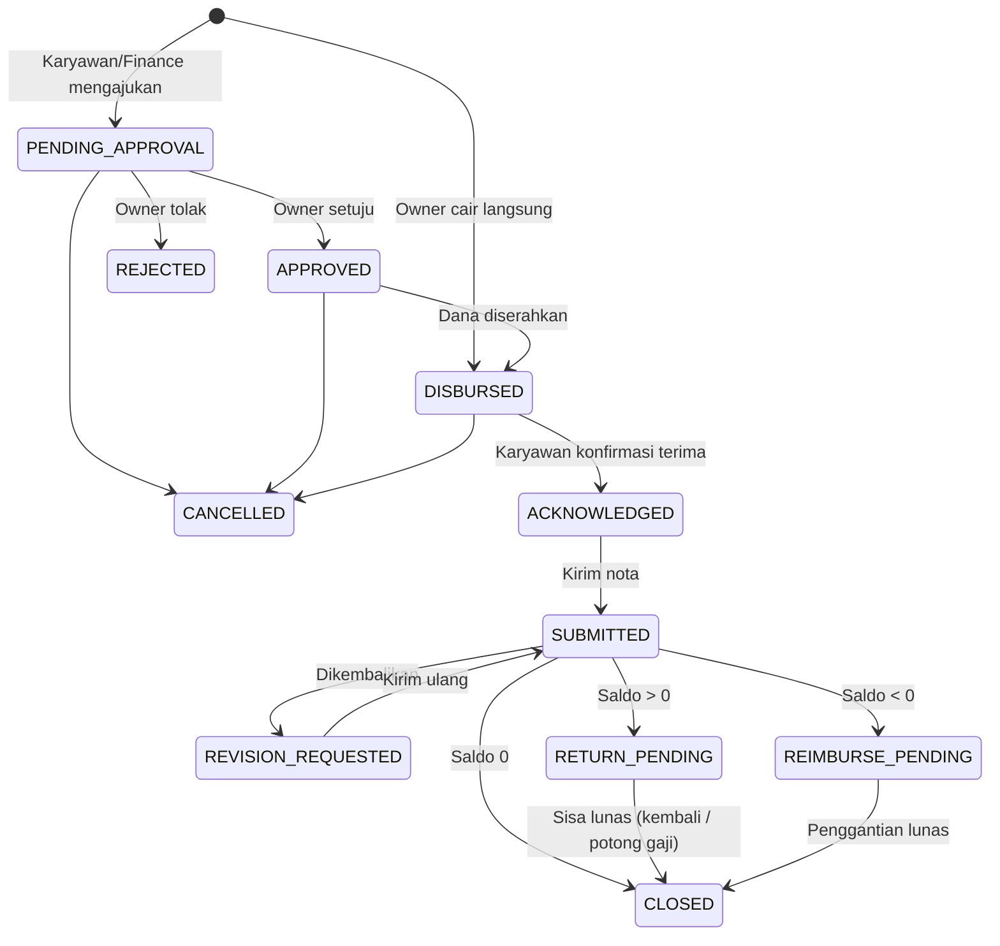

# Alur Bisnis ArchiPay

Acuan untuk memahami cara kerja **Uang Muka** (kas bon operasional) dan
**Pertanggungjawaban** (laporan penggunaan dana + nota) di ArchiPay: siapa
melakukan apa, kapan, dan apa akibatnya. Dokumen ini menjelaskan aturan
bisnis; struktur kode ada di [ARCHITECTURE.md](./ARCHITECTURE.md).

Ditulis berdasarkan kode per 30 Oktober 2026. Bila aturan di kode berubah,
perbarui dokumen ini juga. Sumber kebenaran aturan:

| Aturan | File |
|---|---|
| Hak akses per role | `src/lib/auth/permissions.ts` |
| Siapa boleh melakukan apa terhadap uang muka | `src/features/advances/service.ts` |
| Siapa boleh melakukan apa terhadap pertanggungjawaban | `src/features/settlements/service.ts` |
| Daftar & arti status | `src/features/advances/constants.ts` |
| Pengingat otomatis | `src/features/reminders/run.ts` |
| Project (kartu pilihan, kelola, menetapkan project) | `src/features/projects/` |

---

## 1. Istilah

| Istilah | Arti |
|---|---|
| **Project** | Pengelompok uang muka, mis. "Renovasi Gedung A". Uang muka selalu diajukan di dalam satu project. Dikelola Owner (lihat bagian 15). |
| **Uang muka** (UM) | Dana operasional yang diserahkan kantor ke karyawan sebelum dipakai. Nomor: `UM-2026-10-0001`. |
| **Pertanggungjawaban** (PJ) | Laporan karyawan berisi nota-nota pemakaian uang muka. Satu uang muka = satu laporan. Nomor: `PJ-2026-10-0001`. |
| **Nota** | Satu baris biaya: tanggal, kategori, keterangan, nominal, dan foto/PDF bukti (atau alasan bila tanpa nota). |
| **Saldo** | Uang kantor yang masih dipegang karyawan. Dihitung dari *ledger*, bukan disimpan sebagai angka. |
| **Ledger** | Buku besar per uang muka (`advance_ledger_entries`). Setiap pergerakan uang adalah satu baris. |
| **Sisa** | Saldo positif setelah verifikasi: karyawan wajib mengembalikan. |
| **Penggantian** | Saldo negatif setelah verifikasi: karyawan nombok, kantor wajib mengganti. |
| **Potong gaji** | Sisa yang tidak dikembalikan sampai batas waktu, dipotong dari gaji sesuai persetujuan karyawan. |

---

## 2. Peran & hak akses

Satu user boleh punya lebih dari satu role; haknya digabung.

| Kemampuan | Owner | Finance | Karyawan |
|---|:---:|:---:|:---:|
| Melihat uang muka milik sendiri | ✓ | ✓ | ✓ |
| Melihat uang muka semua karyawan | ✓ | ✓ | |
| **Mencairkan langsung** (tanpa persetujuan) | ✓ | | |
| **Mengusulkan** uang muka untuk karyawan (perlu persetujuan Owner) | ✓¹ | ✓ | |
| **Menyetujui / menolak** pengajuan & usulan | ✓ | | |
| Mengajukan uang muka untuk diri sendiri | | ✓ | ✓ |
| Mengunggah nota & mengirim pertanggungjawaban | ✓ | ✓ | ✓ |
| Memverifikasi nota, mencatat pengembalian / penggantian | ✓ | ✓ | |
| Memilih project aktif saat mengajukan/mencairkan uang muka | ✓ | ✓ | ✓ |
| Mengelola project (tambah, ubah, nilai kontrak, tandai selesai) | ✓ | | |
| Potong Gaji (lihat daftar, ekspor Excel, tandai dipotong) | ✓ | ✓ | |
| Pengguna, Pengaturan, Audit Log | ✓ | | |

¹ Owner selalu memakai jalur "cair langsung", jadi praktis tidak pernah mengusulkan.

### Aturan pemisahan tugas (berlaku untuk semua role)

- Pemberi dan penerima dana harus orang berbeda.
- Penerima dana tidak boleh menyetujui, mencairkan, atau memverifikasi uang mukanya sendiri, **termasuk bila ia Owner atau Finance**.
- Pengusul tidak boleh menyetujui usulannya sendiri.
- Tidak boleh menandai potong gaji untuk diri sendiri.
- Owner tidak bisa mengajukan uang muka untuk dirinya sendiri. Dana perusahaan memang di tangannya, dan tidak ada orang lain yang berhak menyetujuinya.
- Pengajuan/usulan hanya bisa dibuat bila ada **penyetuju yang sah**, yaitu Owner aktif yang bukan penerima dan bukan pengusulnya. Ini mencegah pengajuan macet selamanya, misalnya Finance mengusulkan untuk satu-satunya Owner.

---

## 3. Siklus status uang muka

Status hanya disimpan di satu tempat: `advance_requests.status`. Status
pertanggungjawaban adalah "tampilan" dari status uang muka yang sama.

| Status | Label di aplikasi | Menunggu siapa |
|---|---|---|
| `PENDING_APPROVAL` | Menunggu persetujuan | Owner |
| `APPROVED` | Disetujui, belum dicairkan | Owner/Finance menyerahkan dana |
| `REJECTED` | Ditolak | (selesai) |
| `DISBURSED` | Menunggu konfirmasi | Karyawan penerima |
| `ACKNOWLEDGED` | Diterima karyawan (laporan: Draf) | Karyawan mengisi nota |
| `SUBMITTED` | Nota menunggu verifikasi | Owner/Finance |
| `REVISION_REQUESTED` | Nota perlu diperbaiki | Karyawan |
| `RETURN_PENDING` | Sisa belum dikembalikan | Karyawan mengembalikan / potong gaji |
| `REIMBURSE_PENDING` | Menunggu penggantian | Owner/Finance membayar |
| `CLOSED` | Selesai | (selesai) |
| `CANCELLED` | Dibatalkan | (selesai) |

"Lewat batas" (nota atau pengembalian) **bukan** status. Ia dihitung dari
tanggal batas setiap kali halaman dibuka, jadi selalu benar tanpa cron.

---

## 4. Memberikan uang muka

### 4.0 Navigasi & pilih project dulu (semua role)

Aplikasi tidak memakai sidebar. Setelah login, halaman `/` menampilkan
**kotak menu** (ikon) dengan **kolom pencarian**. Menu yang tampil sesuai role:
Beranda, Project, Potong Gaji, Pengguna, Audit Log, Pengaturan. Header di
setiap halaman berisi logo (kembali ke kotak menu), breadcrumb, dan menu
user. Konten dibatasi container di tengah layar.

**Uang Muka** dan **Pertanggungjawaban** bukan menu. Keduanya dibuka dari
**kartu project** di menu **Project**, sehingga selalu terikat ke satu project
(alamat `/advances?project=<id>` dan `/settlements?project=<id>`). Membuka
alamat itu tanpa project yang valid kembali ke `/projects`.

- **Kartu project:** klik kartu = **detail project**. Badge **Uang Muka** dan **Pertanggungjawaban** di kartu langsung membuka daftarnya (dengan angka hitungan bila ada).
- **Isi kartu per role:** Owner melihat **nilai kontrak dan pengeluaran** (dengan batang pemakaian nilai kontrak). Finance dan karyawan hanya melihat hitungan uang muka (karyawan miliknya sendiri), **tanpa angka kontrak/keuntungan**.
- **Status:** pojok kanan bawah kartu menampilkan status project (**Aktif** / **Selesai**) sebagai informasi. Status diubah Owner di **halaman detail project** (Tandai selesai / Aktifkan lagi, dengan konfirmasi).
- **Daftar & pencarian:** semua project tampil dalam satu daftar, **terbaru dulu** (project baru di kiri atas; "Tanpa project" paling akhir). Kolom pencarian mencari **nama project atau klien**, langsung saat mengetik sejak huruf pertama, tanpa Enter (disaring di browser).
- Pita **"Anda sedang di project X"** selalu tampil di atas daftar uang muka / pertanggungjawaban, dengan tombol **Ganti project** (kembali ke `/projects`).
- Tombol **Ajukan uang muka** / **Catat pencairan** / **Usulkan pencairan** hanya ada di dalam project yang berstatus Aktif. Form tidak meminta project lagi; project terbawa dari halaman sebelumnya dan tampil di pita atas form.
- Server Action mengecek ulang: uang muka baru wajib punya project dan project-nya harus Aktif.
- Project Selesai dan **"Tanpa project"** (uang muka lama sebelum fitur project) muncul di bagian "Project selesai & lainnya". Untuk Finance/karyawan hanya bila mereka punya uang muka di dalamnya; Owner melihat semua project.

Ada tiga jalur. Semuanya berakhir di status `DISBURSED`, lalu karyawan wajib
mengonfirmasi.

### 4.1 Owner mencairkan langsung (push)

1. Owner membuka **Uang Muka → Pencairan uang muka**, memilih karyawan, mengisi nominal, keperluan, dan metode (Tunai/Transfer + nomor referensi opsional).
2. Dana langsung tercatat **cair** (`DISBURSED`). Batas unggah nota mulai dihitung.
3. Karyawan menerima WhatsApp untuk konfirmasi.

### 4.2 Finance mengusulkan (push dengan persetujuan)

1. Finance membuat usulan untuk karyawan → `PENDING_APPROVAL`. Penerima yang tidak punya penyetuju sah tidak muncul di daftar.
2. Owner menerima WhatsApp, lalu **Setujui** (→ `APPROVED`) atau **Tolak** dengan alasan (→ `REJECTED`, Finance menerima WhatsApp).
3. Setelah dana benar-benar diserahkan, Owner/Finance menekan **Catat pencairan** (→ `DISBURSED`). Batas unggah nota mulai dihitung dari saat ini.
4. Karyawan menerima WhatsApp untuk konfirmasi.

### 4.3 Karyawan mengajukan (pull)

1. Karyawan membuka **Ajukan uang muka** → `PENDING_APPROVAL`. Penerimanya selalu dirinya sendiri.
2. Owner menerima WhatsApp, lalu setuju atau tolak. Bila ditolak, karyawan menerima WhatsApp beserta alasannya.
3. Owner/Finance menyerahkan dana lalu **Catat pencairan** (→ `DISBURSED`).

Untuk metode Transfer, rekening tujuan diambil dari data rekening karyawan di
menu Pengguna dan disimpan sebagai salinan saat pencairan.

---

## 5. Konfirmasi terima & persetujuan potong gaji

Saat status `DISBURSED`, karyawan penerima membaca pernyataan lalu mencentang
persetujuan:

> Saya, {nama}, menyatakan telah menerima uang muka {nomor} sebesar {nominal}
> untuk keperluan "{keperluan}". Saya akan mengunggah nota pertanggungjawaban
> paling lambat {tanggal} pukul 23.59. Saya setuju bahwa sisa dana yang belum
> saya kembalikan dalam {N} hari kalender setelah pertanggungjawaban
> diverifikasi akan dipotong dari gaji saya sesuai ketentuan perusahaan.

- Teks **persis** tersebut, waktu, dan alamat IP disimpan sebagai bukti persetujuan tertulis (dasar: PP 36/2021 tentang Pengupahan). Redaksinya perlu dicek konsultan HR/hukum perusahaan.
- Setelah konfirmasi: status → `ACKNOWLEDGED`, ledger mencatat **Dana diterima** (+), dan laporan pertanggungjawaban berstatus **Draf** otomatis dibuat. Owner dan pencair dana menerima WhatsApp.
- Bila dana tidak sesuai, karyawan bisa **Laporkan tidak sesuai** (sekali) dengan alasan. Owner dan pencair dana menerima WhatsApp. Karyawan tetap bisa mengonfirmasi nanti bila ternyata sesuai.

### Pembatalan

| Status | Siapa boleh membatalkan |
|---|---|
| `PENDING_APPROVAL` | Pengaju/pengusul (menarik pengajuan). Owner memakai "Tolak". |
| `APPROVED` | Pengaju/pengusul, atau Owner (bukan penerima). |
| `DISBURSED` | Pencair dana atau Owner (bukan penerima). Karyawan menerima WhatsApp. |
| `ACKNOWLEDGED` dan seterusnya | Tidak bisa dibatalkan. Koreksi dilakukan lewat pertanggungjawaban. |

Alasan pembatalan wajib (minimal 5 karakter).

---

## 6. Pertanggungjawaban

### 6.1 Mengisi nota (karyawan penerima)

- Nota bisa ditambah/dihapus selama status **Draf** (`ACKNOWLEDGED`) atau **Perlu diperbaiki** (`REVISION_REQUESTED`).
- Setiap nota: tanggal (antara tanggal pencairan dan hari ini), kategori aktif, keterangan, nominal, dan foto/PDF maksimal 4 MB. Foto dikompres di HP sebelum diunggah.
- **Tanpa nota** (parkir, ojek, dll) boleh untuk nominal ≤ batas di Pengaturan (bawaan Rp50.000 per item), dengan alasan wajib.
- Maksimal 50 nota per laporan.

### 6.2 Mengirim

- **Kirim pertanggungjawaban** butuh minimal satu nota. Nomor `PJ-…` diberikan saat pertama kali dikirim.
- Pengiriman yang melewati batas unggah nota **tetap diterima**, tetapi ditandai terlambat di WhatsApp ke Owner dan pencair dana.
- Pengiriman terlambat **wajib menyertakan alasan keterlambatan** lewat dialog kirim. Alasan itu disimpan di laporan dan ditampilkan sebagai tanda seru (!) kuning di samping nomor transaksi, di daftar maupun di header detail. Kursor (atau tekan) di tanda seru untuk melihat alasannya.
- Setelah dikirim, nota terkunci (→ `SUBMITTED`).

### 6.3 Verifikasi (Owner/Finance, bukan penerima)

- Setiap nota diputuskan **Setujui** atau **Tolak** (alasan wajib minimal 5 karakter). Nota yang ditolak bersifat final dan tidak dihitung.
- **Selesaikan verifikasi**: nota yang disetujui dicatat ke ledger sebagai **Nota disetujui** (−), lalu hasilnya ditentukan dari saldo:

| Saldo setelah verifikasi | Status | Artinya |
|---|---|---|
| = 0 | `CLOSED` | Selesai. |
| > 0 | `RETURN_PENDING` | Karyawan wajib mengembalikan sisa paling lambat N hari (Pengaturan, bawaan 3 hari). |
| < 0 | `REIMBURSE_PENDING` | Kantor wajib mengganti kekurangan. |

- Alternatifnya, **Kembalikan untuk diperbaiki** dengan catatan (→ `REVISION_REQUESTED`). Keputusan per nota yang belum disimpan ikut dibuang. Karyawan memperbaiki lalu **Kirim ulang**.
- Karyawan menerima WhatsApp untuk hasil verifikasi maupun permintaan perbaikan.

---

## 7. Saldo & ledger

Saldo = jumlah seluruh baris ledger uang muka tersebut. Uang dihitung dalam
rupiah bulat (tanpa desimal).

| Jenis baris | Tanda | Dicatat saat |
|---|:---:|---|
| Dana diterima (`DISBURSEMENT`) | + | Karyawan mengonfirmasi terima |
| Nota disetujui (`EXPENSE_APPROVED`) | − | Verifikasi selesai |
| Sisa dana dikembalikan (`RETURN`) | − | Owner/Finance mencatat pengembalian |
| Potong gaji (`PAYROLL_DEDUCTION`) | − | Owner/Finance menandai dipotong |
| Penggantian dibayar (`REIMBURSEMENT`) | + | Owner/Finance mencatat penggantian |

Contoh: dana Rp500.000, nota disetujui Rp420.000 → saldo +Rp80.000 →
`RETURN_PENDING`. Karyawan mengembalikan Rp50.000 tunai, lalu Rp30.000 dipotong
dari gaji → saldo 0 → `CLOSED`.

---

## 8. Pengembalian, penggantian & potong gaji

### 8.1 Pengembalian sisa / penggantian kekurangan

- Dicatat Owner/Finance (bukan penerima) **setelah uang benar-benar diterima/diserahkan**, dengan metode Tunai/Transfer.
- Boleh dicicil. Nominal tidak boleh melebihi sisa saldo.
- Saat saldo menjadi 0, status otomatis `CLOSED`. Karyawan menerima WhatsApp setiap kali ada pencatatan.

### 8.2 Potong gaji (menu Potong Gaji)

- Daftar **Belum dipotong** berisi uang muka `RETURN_PENDING` yang **sudah lewat batas pengembalian**.
- **Ekspor Excel** (`potong-gaji-YYYY-MM-DD.xlsx`) untuk bagian penggajian. Bila daftar kosong, tidak ada file; yang muncul pemberitahuan.
- Setelah potongan benar-benar diterapkan di penggajian, tekan **Tandai dipotong**: isi nominal (boleh sebagian) dan periode gaji.
- Total potongan per periode maksimal **50% upah** (PP 36/2021). ArchiPay tidak menyimpan data gaji, jadi batas ini dicek bagian penggajian. Bila lebih, potong sebagian dan sisanya di periode berikutnya.
- **Riwayat potongan** bisa difilter per tahun/bulan periode gaji.

---

## 9. Batas waktu & pengingat otomatis

| Batas | Dihitung dari | Bawaan |
|---|---|---|
| Unggah nota | Saat dana dicairkan, berakhir pukul 23.59 hari ke-N (zona waktu perusahaan) | 3 hari kalender |
| Pengembalian sisa | Saat pertanggungjawaban diverifikasi | 3 hari kalender |

Nilai N diatur Owner di **Pengaturan** (1–60 hari).

### Pembatasan uang muka tertunda

Karyawan yang punya **uang muka tertunda** (sudah lewat batas unggah nota,
belum dipertanggungjawabkan) tidak bisa menerima uang muka baru. Uang muka
tertunda dihitung dari status *Menunggu konfirmasi*, *Diterima karyawan*, dan
*Nota perlu diperbaiki*. Jumlah batasnya diatur Owner di Pengaturan (bawaan 2).

- Berlaku untuk pengajuan sendiri (karyawan) maupun pencairan/usulan dari Owner atau Finance.
- Setelah karyawan mengirim pertanggungjawaban, uang muka tersebut tidak lagi dihitung sebagai tertunda, sehingga karyawan bisa menerima uang muka lagi. Batas disimpan per uang
muka saat terjadi, jadi perubahan pengaturan tidak mengubah uang muka yang
sudah berjalan.

Pengingat WhatsApp dikirim oleh cron harian (`/api/cron/reminders`, pukul
08.00 WIB). Setiap jenis hanya dikirim **sekali** per uang muka:

| Pengingat | Kondisi | Penerima |
|---|---|---|
| Batas nota besok | Nota belum dikirim, batasnya besok | Karyawan |
| Batas nota terlewati | Nota belum dikirim, batas lewat | Karyawan + Owner |
| Batas pengembalian besok | Sisa belum lunas, batasnya besok | Karyawan |
| Batas pengembalian terlewati | Sisa belum lunas, batas lewat (masuk daftar Potong Gaji) | Karyawan + Owner |

---

## 10. Notifikasi

WhatsApp dikirim lewat Fonnte; email lewat Resend. Pengguna tanpa nomor
WhatsApp dilewati. Saat development (token kosong), pesan hanya dicetak di
terminal `pnpm dev`.

| Kejadian | Penerima | Kanal |
|---|---|---|
| Pengajuan karyawan / usulan Finance baru | Penyetuju sah (Owner) | WhatsApp |
| Pengajuan/usulan ditolak | Pengaju/pengusul | WhatsApp |
| Dana dicairkan | Karyawan penerima | WhatsApp |
| Uang muka cair dibatalkan | Karyawan penerima | WhatsApp |
| Karyawan konfirmasi terima | Owner + pencair dana | WhatsApp |
| Karyawan laporkan tidak sesuai | Owner + pencair dana | WhatsApp |
| Pertanggungjawaban dikirim | Owner + pencair dana | WhatsApp |
| Dikembalikan untuk diperbaiki | Karyawan | WhatsApp |
| Verifikasi selesai | Karyawan | WhatsApp |
| Pengembalian / penggantian / potong gaji dicatat | Karyawan | WhatsApp |
| Pengingat batas waktu | Lihat bagian 9 | WhatsApp |
| Akun dibuat / password di-reset | Pengguna | Email (password sementara) |

Hasil setiap aksi simpan di aplikasi tampil sebagai toast (pojok kanan bawah,
atau atas layar di HP).

---

## 11. Pengguna & akun

- Akun Owner pertama dibuat lewat script `pnpm db:create-owner`. Pengguna lain dibuat Owner di menu **Pengguna** (nama + email); password sementara dikirim lewat email dan wajib diganti saat login pertama.
- Nomor WhatsApp dan rekening bank diisi Owner di halaman edit pengguna. Tanpa nomor, pengguna tidak menerima WhatsApp; tanpa rekening, pencairan Transfer menampilkan peringatan.
- **Reset password**: password sementara baru dikirim lewat email, dan pengguna keluar dari semua perangkat.
- **Nonaktifkan**: pengguna tidak bisa login dan sesi berjalan langsung berhenti. Data dan riwayat tetap tersimpan. Owner tidak bisa menonaktifkan akun sendiri atau melepas role Owner dirinya.
- Sesi login: dengan centang **"Ingat saya"** (14 hari), sesi bertahan di perangkat itu sampai 14 hari sejak login. Tanpa centang, sesi berakhir saat browser ditutup, dan paling lama 12 jam. Sesi tidak diperpanjang karena aktivitas. Sesi berakhir lebih cepat bila user logout, mengganti/mereset password, atau akunnya dinonaktifkan. Login dikunci sementara setelah 5 kali gagal per email (atau 20 kali per IP) dalam 15 menit.

---

## 12. Pengaturan (Owner)

| Pengaturan | Bawaan |
|---|---|
| Batas unggah nota | 3 hari |
| Batas pengembalian sisa dana | 3 hari |
| Batas biaya tanpa nota per item | Rp50.000 (isi 0 bila semua biaya wajib bernota) |
| Batas uang muka tertunda | 2 uang muka (1–10) |
| Kategori biaya | Transportasi, Konsumsi, ATK & Fotokopi, Parkir & Tol, Materai & Perizinan, Lain-lain |

Kategori tidak bisa dihapus agar nota lama tetap utuh; kategori **nonaktif**
tidak muncul lagi di form nota. Mengganti nama kategori ikut mengubah tampilan
nota lama.

---

## 13. Audit log (Owner)

Setiap perubahan penting (login, pengguna, uang muka, pertanggungjawaban,
ledger, potong gaji, pengaturan) dicatat beserta pelaku, waktu, IP, nilai lama
dan nilai baru. Bisa difilter per tahun, bulan, kategori, dan pelaku.

---

## 14. Perusahaan tanpa Finance

Tidak perlu pengaturan khusus; cukup tidak ada user dengan role Finance. Owner
memiliki semua hak Finance, sehingga alurnya menjadi:

- **Owner → Karyawan:** Owner cair langsung → karyawan konfirmasi → karyawan kirim nota → Owner verifikasi → Owner catat pengembalian/penggantian, atau potong gaji.
- **Karyawan → Owner:** karyawan mengajukan → Owner setuju → Owner serahkan dana & catat pencairan → langkah selanjutnya sama.

Satu Owner memegang pencairan, verifikasi, dan pencatatan sekaligus. Ini wajar
untuk usaha kecil karena dananya milik Owner sendiri, dan semua langkah tetap
tercatat di Audit Log.

---

## 15. Project

Menu **Project** (semua role) berisi kartu project: nama, klien (opsional),
ikon, dan status. Owner menambah project dari tombol **Tambah project** (halaman `/projects/new`), dan
melihat **nilai kontrak** (opsional, hanya terlihat Owner) serta pengeluaran.

**Detail project** (klik kartu): identitas project dan kartu akses Uang Muka &
Pertanggungjawaban (dengan rincian hitungan). Khusus Owner: tombol **Ubah
project** (halaman `/projects/[id]/edit`: nama, klien, nilai kontrak, ikon), **Tandai selesai / Aktifkan
lagi**, **PDF**, ringkasan keuangan project, dan pengeluaran per kategori.

- **Aktif / Selesai.** Project Selesai tidak bisa dipilih untuk uang muka baru. Uang muka yang sudah berjalan di dalamnya tetap berjalan, dan daftarnya tetap bisa dibuka. Bisa diaktifkan lagi.
- **Tidak ada hapus**, agar uang muka lama tetap punya induk. Nama project harus unik.
- **Warna mengikuti ikon.** Setiap ikon punya satu warna tetap (12 ikon, 12 warna). Mengganti ikon otomatis mengganti warna kartu, border, dan pita project. Ikon dipilih Owner di form project; pilihan ikonnya tampil dengan warnanya masing-masing.
- **Uang muka lama** (dibuat sebelum fitur project) masuk "Tanpa project". Owner bisa **menetapkan project** dari halaman detail uang muka, selama uang muka itu belum Selesai/Ditolak/Dibatalkan dan belum punya project. Setelah ditetapkan tidak bisa dipindah lagi. Dicatat di Audit Log.
- Semua perubahan project tercatat di Audit Log (kategori **Project**).

### Beranda Owner

Beranda ada di menu **Beranda** (`/beranda`). Hanya Owner yang melihat angka keuangan project. Finance dan karyawan tetap
melihat ringkasan uang muka seperti sebelumnya.

- **Pengeluaran** = nota yang **disetujui** saat verifikasi (ledger `EXPENSE_APPROVED`). Nota yang menunggu verifikasi atau ditolak tidak dihitung.
- **Keuntungan** = nilai kontrak − pengeluaran, dan margin = keuntungan ÷ nilai kontrak. Hanya dihitung untuk project yang nilai kontraknya diisi. Project **Aktif** ditandai *sementara*, project **Selesai** *final*.
- **Dana beredar** = uang muka yang sudah cair tetapi nota belum diverifikasi. Ini bukan pengeluaran, jadi ditampilkan terpisah.
- **Kartu ringkasan:** nilai kontrak, pengeluaran, keuntungan (+ margin), dan dana beredar.
- **Perlu perhatian:** project yang pengeluarannya melebihi nilai kontrak atau sudah ≥ 80%, uang muka lewat batas nota, menunggu persetujuan, nota menunggu verifikasi, sisa dana belum dikembalikan, project aktif tanpa nilai kontrak, dan uang muka berjalan tanpa project.
- **Keuangan per project:** nilai kontrak, pengeluaran (dengan batang pemakaian nilai kontrak: biru < 80%, kuning ≥ 80%, merah > 100%), keuntungan, dan dana beredar. Nama project membuka detail project.
- **Grafik:** pengeluaran per kategori (semua project) dan per bulan untuk 6 bulan terakhir menurut tanggal di nota.

### Laporan PDF per project

Tombol **PDF** di tabel "Keuangan per project" (Beranda Owner) dan di detail project mengunduh laporan
satu project. Hanya Owner. PDF dibuat saat diminta dengan data terbaru, tidak
disimpan. Isinya (A4, foto nota tidak disertakan):

1. **Ringkasan:** nilai kontrak, pengeluaran, keuntungan dan margin (*sementara* / *final*), dana beredar, uang muka dicairkan, dan jumlah nota.
2. **Pengeluaran per kategori:** jumlah nota, total, dan porsinya.
3. **Per karyawan:** jumlah uang muka, total dicairkan, dan pengeluaran yang disetujui.
4. **Daftar nota yang disetujui:** tanggal nota, nomor pertanggungjawaban, karyawan, kategori, keterangan (biaya tanpa nota diberi tanda), dan jumlah.

Kartu "Tanpa project" tidak punya PDF karena tidak punya nilai kontrak.

---

## 16. Catatan terbuka

Hal yang sudah diketahui tetapi belum diputuskan/dikerjakan:

1. **Persetujuan belum diberitahukan.** Saat Owner menyetujui, belum ada WhatsApp ke pengusul (misal Finance yang perlu mencatat pencairan). Karyawan baru diberi tahu saat dana dicairkan.
2. **Finance bisa memegang uang sekaligus mencatatnya.** Finance yang sama boleh mencairkan, memverifikasi, dan mencatat pengembalian untuk uang muka yang sama; pencatatan pengembalian hanya diberitahukan ke karyawan, bukan ke Owner.
3. **Finance tidak menerima pengingat keterlambatan**, hanya karyawan dan Owner.
4. **Nota yang tidak pernah dikirim tidak masuk Potong Gaji.** Daftar Potong Gaji hanya memuat sisa setelah verifikasi. Untuk mencegahnya, karyawan dibatasi menerima uang muka baru bila jumlah uang muka tertundanya sudah mencapai batas di Pengaturan (lihat bagian 9). Uang muka yang sudah terlanjur tertunda tetap harus ditagih manual.
5. **Pengajuan yang sudah terlanjur macet** (dibuat sebelum pengecekan penyetuju sah ditambahkan) tidak berubah otomatis; pengusulnya bisa membatalkan.
6. **Notifikasi WhatsApp belum menyebut project.** Pesan pengajuan, pencairan, dan pengingat belum memuat nama project.
