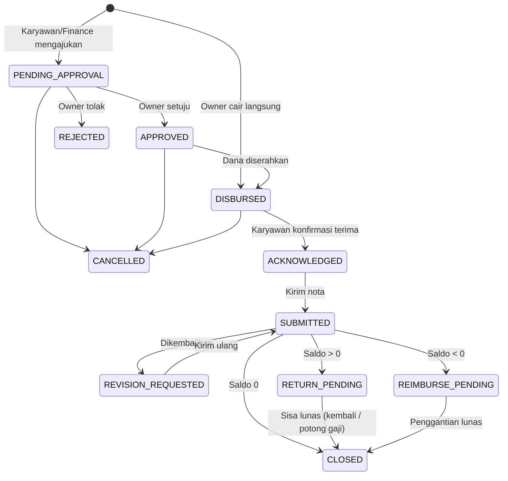

# Alur Bisnis ArchiPay

Acuan untuk memahami cara kerja **Uang Muka** (kas bon operasional) dan
**Pertanggungjawaban** (laporan penggunaan dana + nota) di ArchiPay: siapa
melakukan apa, kapan, dan apa akibatnya. Dokumen ini menjelaskan aturan
bisnis; struktur kode ada di [ARCHITECTURE.md](./ARCHITECTURE.md).

Ditulis berdasarkan kode per 31 Oktober 2026. Bila aturan di kode berubah,
perbarui dokumen ini juga. Sumber kebenaran aturan:

| Aturan | File |
|---|---|
| Hak akses per role | `src/lib/auth/permissions.ts` |
| Siapa boleh melakukan apa terhadap uang muka | `src/features/advances/service.ts` |
| Siapa boleh melakukan apa terhadap pertanggungjawaban | `src/features/settlements/service.ts` |
| Daftar & arti status | `src/features/advances/constants.ts` |
| Pengingat otomatis | `src/features/reminders/run.ts` |
| Project (kartu pilihan, kelola, menetapkan project) | `src/features/projects/` |
| Company (klien), masuk company untuk Superadmin | `src/features/companies/`, `src/lib/auth/dal.ts` |
| Absensi: lokasi, jam kerja, hari libur, foto acuan wajah | `src/features/attendance/` |
| Add-on (Absensi, Penggajian): masa aktif & harga | `src/lib/addons.ts`, `src/features/subscriptions/pricing.ts` |
| Penggajian: data gaji, penggajian bulanan, Slip Gaji | `src/features/salaries/` |

---

## 1. Istilah

| Istilah | Arti |
|---|---|
| **Company** | Klien ArchiPay (perusahaan pengguna). Semua data (pengguna, project, uang muka, pengaturan, audit log) milik satu company dan tidak terlihat company lain. Dibuat Superadmin (lihat bagian 16). |
| **Project** | Pengelompok uang muka, mis. "Renovasi Gedung A". Uang muka selalu diajukan di dalam satu project. Dikelola Owner (lihat bagian 15). |
| **Uang muka** (UM) | Dana operasional yang diserahkan kantor ke karyawan sebelum dipakai. Nomor: `UM-2026-10-0001`. |
| **Pertanggungjawaban** (PJ) | Laporan karyawan berisi nota-nota pemakaian uang muka. Satu uang muka = satu laporan. Nomor: `PJ-2026-10-0001`. |
| **Nota** | Satu baris biaya: tanggal, kategori, keterangan, nominal, dan foto/PDF bukti (atau alasan bila tanpa nota). |
| **Saldo** | Uang kantor yang masih dipegang karyawan. Dihitung dari *ledger*, bukan disimpan sebagai angka. |
| **Ledger** | Buku besar per uang muka (`advance_ledger_entries`). Setiap pergerakan uang adalah satu baris. |
| **Sisa** | Saldo positif setelah verifikasi: karyawan wajib mengembalikan. |
| **Penggantian** | Saldo negatif setelah verifikasi: karyawan nombok, kantor wajib mengganti. |
| **Potong gaji** | Sisa yang tidak dikembalikan sampai batas waktu, dipotong dari gaji sesuai persetujuan karyawan. |

---

## 2. Peran & hak akses

Satu user boleh punya lebih dari satu role; haknya digabung. Urutan
pendaftaran akun: **Superadmin → Company + Owner → karyawan** (Finance,
Admin HR & Karyawan). Hak akses absensi (termasuk role **Admin HR**) ada di
bagian 18.1. Owner, Finance, dan Karyawan selalu milik satu company; Superadmin
tidak terikat company mana pun.

| Kemampuan | Superadmin | Owner | Finance | Karyawan |
|---|:---:|:---:|:---:|:---:|
| Melihat uang muka milik sendiri | | ✓ | ✓ | ✓ |
| Melihat uang muka semua karyawan | ✓ | ✓ | ✓ | |
| **Mencairkan langsung** (tanpa persetujuan) | | ✓ | | |
| **Mengusulkan** uang muka untuk karyawan (perlu persetujuan Owner) | | ✓¹ | ✓ | |
| **Menyetujui / menolak** pengajuan & usulan | | ✓ | | |
| Mengajukan uang muka untuk diri sendiri | | | ✓ | ✓ |
| Mengunggah nota & mengirim pertanggungjawaban | | ✓ | ✓ | ✓ |
| Memverifikasi nota, mencatat pengembalian / penggantian | | ✓ | ✓ | |
| Memilih project aktif saat mengajukan/mencairkan uang muka | | ✓ | ✓ | ✓ |
| Melihat nilai kontrak, keuntungan per project, unduh PDF laporan | ✓ | ✓ | | |
| Mengelola project (tambah, ubah, nilai kontrak, tandai selesai, tetapkan project uang muka lama) | | ✓ | | |
| Potong Gaji: lihat daftar & ekspor Excel | ✓ | ✓ | ✓ | |
| Potong Gaji: tandai dipotong | | ✓ | ✓ | |
| Pengguna: kelola akun Finance & Karyawan | ✓ | ✓ | | |
| Pengguna: kelola akun Karyawan saja, tanpa rekening bank (juga **Admin HR**, bagian 18.1) | | ✓ | | |
| Pengguna: kelola akun Owner (termasuk memberi/mencabut role Owner) | ✓ | | | |
| Pengaturan: melihat | ✓ | ✓ | | |
| Pengaturan: mengubah kebijakan uang muka & kategori biaya | | ✓ | | |
| Audit Log | ✓ | ✓ | | |
| Company: tambah, ubah, aktif/nonaktif, hapus, masuk ke company | ✓ | | | |
| Tagihan & Pengaturan platform (verifikasi bayar, harga, rekening, QRIS) | ✓ | | | |
| Langganan company sendiri (pilih paket, kirim bukti bayar) | | ✓ | | |

¹ Owner selalu memakai jalur "cair langsung", jadi praktis tidak pernah mengusulkan.

### Superadmin

- Dibuat lewat script `pnpm db:create-superadmin`, tidak bisa dibuat dari aplikasi.
- Mengelola company (menu **Company**), yang juga menjadi halaman pertama setelah login. Company tampil sebagai kartu (klik kartu = detail company) dengan pencarian nama company/Owner dan saring status. Untuk melihat data sebuah company, Superadmin menekan **Buka** pada kartu atau detail company itu; selama company dibuka, pita "Melihat company …" tampil di bawah header dengan tombol Ganti/Keluar, satu-satunya jalan kembali ke halaman Company (menu Company tidak ada di kotak menu company, dan halaman Company tidak punya tombol kembali ke menu). Kolom ✓ Superadmin di tabel atas berlaku untuk company yang sedang dibuka.
- Membuka semua menu company dan melihat semua datanya, tetapi **tidak melakukan transaksi uang** (mencairkan, menyetujui, memverifikasi nota, mencatat pengembalian/penggantian, potong gaji).
- **Project dan Pengaturan company baca saja**: tidak bisa menambah/mengubah project, mengubah status, atau menetapkan project uang muka lama, dan tidak bisa mengubah kebijakan uang muka maupun kategori biaya. Semua itu diatur Owner.
- **Tidak tampil di UI mana pun**: daftar Pengguna, filter Pelaku di Audit Log, pilihan penerima uang muka, daftar penyetuju, kontak WhatsApp, dan nama "terakhir diubah" di Pengaturan.
- **Tindakannya tidak dicatat ke audit log**, termasuk login/logout dan percobaan login gagal ke akunnya.

### Aturan pemisahan tugas (berlaku untuk semua role)

- Pemberi dan penerima dana harus orang berbeda.
- Penerima dana tidak boleh menyetujui, mencairkan, atau memverifikasi uang mukanya sendiri, **termasuk bila ia Owner atau Finance**.
- Pengusul tidak boleh menyetujui usulannya sendiri.
- Tidak boleh menandai potong gaji untuk diri sendiri.
- Owner tidak bisa mengajukan uang muka untuk dirinya sendiri. Dana perusahaan memang di tangannya, dan tidak ada orang lain yang berhak menyetujuinya.
- Pengajuan/usulan hanya bisa dibuat bila ada **penyetuju yang sah**, yaitu Owner aktif yang bukan penerima dan bukan pengusulnya. Ini mencegah pengajuan macet selamanya, misalnya Finance mengusulkan untuk satu-satunya Owner.

---

## 3. Siklus status uang muka

Status hanya disimpan di satu tempat: `advance_requests.status`. Status
pertanggungjawaban adalah "tampilan" dari status uang muka yang sama.



| Status | Label di aplikasi | Menunggu siapa |
|---|---|---|
| `PENDING_APPROVAL` | Menunggu persetujuan | Owner |
| `APPROVED` | Disetujui, belum dicairkan | Owner/Finance menyerahkan dana |
| `REJECTED` | Ditolak | (selesai) |
| `DISBURSED` | Menunggu konfirmasi | Karyawan penerima |
| `ACKNOWLEDGED` | Diterima karyawan (laporan: Draf) | Karyawan mengisi nota |
| `SUBMITTED` | Nota menunggu verifikasi | Owner/Finance |
| `REVISION_REQUESTED` | Nota perlu diperbaiki | Karyawan |
| `RETURN_PENDING` | Sisa belum dikembalikan | Karyawan mengembalikan / potong gaji |
| `REIMBURSE_PENDING` | Menunggu penggantian | Owner/Finance membayar |
| `CLOSED` | Selesai | (selesai) |
| `CANCELLED` | Dibatalkan | (selesai) |

"Lewat batas" (nota atau pengembalian) **bukan** status. Ia dihitung dari
tanggal batas setiap kali halaman dibuka, jadi selalu benar tanpa cron.

---

## 4. Memberikan uang muka

### 4.0 Navigasi & pilih project dulu (semua role)

Aplikasi tidak memakai sidebar. Setelah login, halaman `/` menampilkan
**kotak menu** (ikon) dengan **kolom pencarian**. Menu yang tampil sesuai role:
Beranda, Project, Potong Gaji, Pengguna, Audit Log, Pengaturan. Header di
setiap halaman berisi logo (kembali ke kotak menu), breadcrumb, dan menu
user. Konten dibatasi container di tengah layar.

**Uang Muka** dan **Pertanggungjawaban** bukan menu. Keduanya dibuka dari
**kartu project** di menu **Project**, sehingga selalu terikat ke satu project
(alamat `/advances?project=<id>` dan `/settlements?project=<id>`). Membuka
alamat itu tanpa project yang valid kembali ke `/projects`.

- **Kartu project:** klik kartu = **detail project**. Badge **Uang Muka** dan **Pertanggungjawaban** di kartu langsung membuka daftarnya (dengan angka hitungan bila ada).
- **Isi kartu per role:** Owner melihat **nilai kontrak dan pengeluaran** (dengan batang pemakaian nilai kontrak). Finance dan karyawan hanya melihat hitungan uang muka (karyawan miliknya sendiri), **tanpa angka kontrak/keuntungan**.
- **Status:** pojok kanan bawah kartu menampilkan status project (**Aktif** / **Selesai**) sebagai informasi. Status diubah Owner di **halaman detail project** (Tandai selesai / Aktifkan lagi, dengan konfirmasi).
- **Daftar & pencarian:** semua project tampil dalam satu daftar, **terbaru dulu** (project baru di kiri atas; "Tanpa project" paling akhir). Kolom pencarian mencari **nama project atau klien**, langsung saat mengetik sejak huruf pertama, tanpa Enter (disaring di browser).
- Pita **"Anda sedang di project X"** selalu tampil di atas daftar uang muka / pertanggungjawaban, dengan tombol **Ganti project** (kembali ke `/projects`).
- Tombol **Ajukan uang muka** / **Catat pencairan** / **Usulkan pencairan** hanya ada di dalam project yang berstatus Aktif. Form tidak meminta project lagi; project terbawa dari halaman sebelumnya dan tampil di pita atas form.
- Server Action mengecek ulang: uang muka baru wajib punya project dan project-nya harus Aktif.
- Project Selesai dan **"Tanpa project"** (uang muka lama sebelum fitur project) muncul di bagian "Project selesai & lainnya". Untuk Finance/karyawan hanya bila mereka punya uang muka di dalamnya; Owner melihat semua project.

Ada tiga jalur. Semuanya berakhir di status `DISBURSED`, lalu karyawan wajib
mengonfirmasi.

### 4.1 Owner mencairkan langsung (push)

1. Owner membuka **Uang Muka → Pencairan uang muka**, memilih karyawan, mengisi nominal, keperluan, dan metode (Tunai/Transfer + nomor referensi opsional).
2. Dana langsung tercatat **cair** (`DISBURSED`). Batas unggah nota mulai dihitung.
3. Karyawan menerima WhatsApp untuk konfirmasi.

### 4.2 Finance mengusulkan (push dengan persetujuan)

1. Finance membuat usulan untuk karyawan → `PENDING_APPROVAL`. Penerima yang tidak punya penyetuju sah tidak muncul di daftar.
2. Owner menerima WhatsApp, lalu **Setujui** (→ `APPROVED`) atau **Tolak** dengan alasan (→ `REJECTED`, Finance menerima WhatsApp).
3. Setelah dana benar-benar diserahkan, Owner/Finance menekan **Catat pencairan** (→ `DISBURSED`). Batas unggah nota mulai dihitung dari saat ini.
4. Karyawan menerima WhatsApp untuk konfirmasi.

### 4.3 Karyawan mengajukan (pull)

1. Karyawan membuka **Ajukan uang muka** → `PENDING_APPROVAL`. Penerimanya selalu dirinya sendiri.
2. Owner menerima WhatsApp, lalu setuju atau tolak. Bila ditolak, karyawan menerima WhatsApp beserta alasannya.
3. Owner/Finance menyerahkan dana lalu **Catat pencairan** (→ `DISBURSED`).

Untuk metode Transfer, rekening tujuan diambil dari data rekening karyawan di
menu Pengguna dan disimpan sebagai salinan saat pencairan.

---

## 5. Konfirmasi terima & persetujuan potong gaji

Saat status `DISBURSED`, karyawan penerima membaca pernyataan lalu mencentang
persetujuan:

> Saya, {nama}, menyatakan telah menerima uang muka {nomor} sebesar {nominal}
> untuk keperluan "{keperluan}". Saya akan mengunggah nota pertanggungjawaban
> paling lambat {tanggal} pukul 23.59. Saya setuju bahwa sisa dana yang belum
> saya kembalikan dalam {N} hari kalender setelah pertanggungjawaban
> diverifikasi akan dipotong dari gaji saya sesuai ketentuan perusahaan.

- Teks **persis** tersebut, waktu, dan alamat IP disimpan sebagai bukti persetujuan tertulis (dasar: PP 36/2021 tentang Pengupahan). Redaksinya perlu dicek konsultan HR/hukum perusahaan.
- Setelah konfirmasi: status → `ACKNOWLEDGED`, ledger mencatat **Dana diterima** (+), dan laporan pertanggungjawaban berstatus **Draf** otomatis dibuat. Owner dan pencair dana menerima WhatsApp.
- Bila dana tidak sesuai, karyawan bisa **Laporkan tidak sesuai** (sekali) dengan alasan. Owner dan pencair dana menerima WhatsApp. Karyawan tetap bisa mengonfirmasi nanti bila ternyata sesuai.

### Pembatalan

| Status | Siapa boleh membatalkan |
|---|---|
| `PENDING_APPROVAL` | Pengaju/pengusul (menarik pengajuan). Owner memakai "Tolak". |
| `APPROVED` | Pengaju/pengusul, atau Owner (bukan penerima). |
| `DISBURSED` | Pencair dana atau Owner (bukan penerima). Karyawan menerima WhatsApp. |
| `ACKNOWLEDGED` dan seterusnya | Tidak bisa dibatalkan. Koreksi dilakukan lewat pertanggungjawaban. |

Alasan pembatalan wajib (minimal 5 karakter).

---

## 6. Pertanggungjawaban

### 6.1 Mengisi nota (karyawan penerima)

- Nota bisa ditambah/dihapus selama status **Draf** (`ACKNOWLEDGED`) atau **Perlu diperbaiki** (`REVISION_REQUESTED`).
- Setiap nota: tanggal (antara tanggal pencairan dan hari ini), kategori aktif, keterangan, nominal, dan foto/PDF maksimal 4 MB. Foto dikompres di HP sebelum diunggah.
- **Tanpa nota** (parkir, ojek, dll) boleh untuk nominal ≤ batas di Pengaturan (bawaan Rp50.000 per item), dengan alasan wajib.
- Maksimal 50 nota per laporan.

### 6.2 Mengirim

- **Kirim pertanggungjawaban** butuh minimal satu nota. Nomor `PJ-…` diberikan saat pertama kali dikirim.
- Pengiriman yang melewati batas unggah nota **tetap diterima**, tetapi ditandai terlambat di WhatsApp ke Owner dan pencair dana.
- Pengiriman terlambat **wajib menyertakan alasan keterlambatan** lewat dialog kirim. Alasan itu disimpan di laporan dan ditampilkan sebagai tanda seru (!) kuning di samping nomor transaksi, di daftar maupun di header detail. Kursor (atau tekan) di tanda seru untuk melihat alasannya.
- Setelah dikirim, nota terkunci (→ `SUBMITTED`).

### 6.3 Verifikasi (Owner/Finance, bukan penerima)

- Setiap nota diputuskan **Setujui** atau **Tolak** (alasan wajib minimal 5 karakter). Nota yang ditolak bersifat final dan tidak dihitung.
- **Selesaikan verifikasi**: nota yang disetujui dicatat ke ledger sebagai **Nota disetujui** (−), lalu hasilnya ditentukan dari saldo:

| Saldo setelah verifikasi | Status | Artinya |
|---|---|---|
| = 0 | `CLOSED` | Selesai. |
| > 0 | `RETURN_PENDING` | Karyawan wajib mengembalikan sisa paling lambat N hari (Pengaturan, bawaan 3 hari). |
| < 0 | `REIMBURSE_PENDING` | Kantor wajib mengganti kekurangan. |

- Alternatifnya, **Kembalikan untuk diperbaiki** dengan catatan (→ `REVISION_REQUESTED`). Keputusan per nota yang belum disimpan ikut dibuang. Karyawan memperbaiki lalu **Kirim ulang**.
- Karyawan menerima WhatsApp untuk hasil verifikasi maupun permintaan perbaikan.
- **Masa simpan file nota**: file foto/PDF nota disimpan di R2 dengan key
  `<companyId>/receipts/<advanceId>/<itemId>.<ext>`. Setelah uang muka
  **Selesai** (`CLOSED`) dan lewat masa simpan (Pengaturan platform, bawaan
  **6 bulan**, dihitung sejak entri ledger terakhir), cron harian menghapus
  filenya (maks. 1.000 file per hari). Item nota tetap ada (nominal,
  keterangan, hasil verifikasi); kolom nota menampilkan "Nota sudah dihapus
  (lewat masa simpan)", dan nota yang sama tetap ditolak bila diunggah ulang.
  Company nonaktif dikecualikan. Bukti bayar langganan tidak ikut dihapus.

---

## 7. Saldo & ledger

Saldo = jumlah seluruh baris ledger uang muka tersebut. Uang dihitung dalam
rupiah bulat (tanpa desimal).

| Jenis baris | Tanda | Dicatat saat |
|---|:---:|---|
| Dana diterima (`DISBURSEMENT`) | + | Karyawan mengonfirmasi terima |
| Nota disetujui (`EXPENSE_APPROVED`) | − | Verifikasi selesai |
| Sisa dana dikembalikan (`RETURN`) | − | Owner/Finance mencatat pengembalian |
| Potong gaji (`PAYROLL_DEDUCTION`) | − | Owner/Finance menandai dipotong |
| Penggantian dibayar (`REIMBURSEMENT`) | + | Owner/Finance mencatat penggantian |

Contoh: dana Rp500.000, nota disetujui Rp420.000 → saldo +Rp80.000 →
`RETURN_PENDING`. Karyawan mengembalikan Rp50.000 tunai, lalu Rp30.000 dipotong
dari gaji → saldo 0 → `CLOSED`.

---

## 8. Pengembalian, penggantian & potong gaji

### 8.1 Pengembalian sisa / penggantian kekurangan

- Dicatat Owner/Finance (bukan penerima) **setelah uang benar-benar diterima/diserahkan**, dengan metode Tunai/Transfer.
- Boleh dicicil. Nominal tidak boleh melebihi sisa saldo.
- Saat saldo menjadi 0, status otomatis `CLOSED`. Karyawan menerima WhatsApp setiap kali ada pencatatan (pengembalian tunai tidak dikabari, hemat kuota).
- Setiap pencatatan menyimpan **tanggal diterima / dibayar** (bawaan hari ini; tidak boleh ke depan, tidak boleh sebelum dana dicairkan, maksimal **30 hari ke belakang**) terpisah dari **waktu dicatat**, dan **foto/PDF bukti opsional** (screenshot transfer atau kuitansi, maks. 4 MB, dikompres di HP). Keduanya tampil di Riwayat saldo; bukti dibuka lewat pratinjau mengambang.
- Nomor referensi transfer tetap opsional dan hanya berupa catatan (tidak dicek ganda: nomor yang panjang rawan salah ketik dan tetap harus dicocokkan dengan mutasi bank).
- Bila karyawan sudah **melapor** pengembalian (8.1.1) dan belum diputuskan, pencatatan langsung ditolak: konfirmasi atau tolak laporannya dulu agar satu pengembalian tidak tercatat dua kali.

### 8.1.1 Laporan pengembalian dari karyawan (2026-11-06)

Pengembalian terjadi di luar sistem (tunai atau transfer). Supaya karyawan tidak ditagih atau dipotong gajinya hanya karena Owner/Finance lupa mencatat, karyawan bisa **melapor lebih dulu**:

1. Di pertanggungjawaban yang sisanya belum kembali, karyawan menekan **Saya sudah mengembalikan**: nominal, cara (tunai/transfer), **tanggal pengembalian**, foto bukti opsional, catatan. Satu laporan menunggu per pertanggungjawaban.
2. Owner/Finance (bukan penerima) mengecek **mutasi rekening** (transfer) atau **kas yang diterima** (tunai) pada tanggal itu, lalu:
   - **Konfirmasi diterima**: nominal dan **tanggal diterima** terisi dari laporan dan boleh dikoreksi (mis. transfer baru masuk keesokan hari). Jadi baris `RETURN` di ledger; saldo berkurang.
   - **Tolak** dengan alasan: karyawan dikabari WhatsApp, sisa tetap tercatat belum kembali, dan ia boleh melapor ulang.
3. Jalur lama tetap ada: Owner/Finance boleh langsung **Catat pengembalian** bila karyawan tidak melapor sendiri.

**Tiga tanggal** (tampil di Riwayat saldo dan Audit Log): *dilaporkan* (otomatis, saat karyawan menekan tombol), *diterima* (tanggal uang benar-benar sampai, diisi karyawan lalu dicek/dikoreksi pemeriksa), *dicatat* (otomatis, saat dikonfirmasi). Jadi karyawan tidak dianggap terlambat karena ia terlambat melapor atau Owner/Finance terlambat mencatat.

**Selama laporan menunggu keputusan** (perlindungan karyawan):
- uang muka tidak ditandai **lewat batas pengembalian**;
- pengingat WhatsApp pengembalian (H-1 dan lewat batas) berhenti (aktif lagi bila laporan ditolak);
- sisanya tidak masuk daftar **Potong Gaji**;
- **penggajian tidak bisa diselesaikan** bila ada laporan lewat-batas dari karyawan di penggajian itu (kotak peringatan menyebut namanya); konfirmasi atau tolak dulu, lalu Hitung ulang;
- laporan muncul di **Perlu tindakan** Owner/Finance ("Konfirmasi laporan pengembalian") dan diberi penanda di daftar pertanggungjawaban; laporan yang belum diputuskan lebih dari **2 hari** masuk **ringkasan email** Owner dan Finance.

Bukti (di laporan maupun di pencatatan langsung) disimpan di R2 privat dan dihapus otomatis cron harian setelah masa simpan nota (Pengaturan platform), sejak uang mukanya Selesai; barisnya tetap ada dan ditandai "dihapus (lewat masa simpan)". Tunai tetap tidak bisa dibuktikan sepenuhnya: yang didapat adalah jejak dua sisi dengan cap waktu.

### 8.1.2 Penggantian kekurangan (kantor nombok) dan konfirmasi karyawan (2026-11-06)

Arah uangnya terbalik dari 8.1.1: kantor membayar karyawan, jadi yang berisiko adalah **karyawan** (dicatat "sudah dibayar" padahal belum menerima) dan kekurangan yang **tidak kunjung dibayar**.

1. Owner/Finance (bukan penerima) menekan **Catat penggantian**: nominal, cara, **tanggal dibayar**, catatan.
   - **Transfer: bukti transfer (screenshot) WAJIB** dilampirkan.
   - **Tunai:** bukti tidak ada; karyawan sendiri yang mengonfirmasi (langkah 2).
2. Pembayaran **langsung tercatat** di buku saldo (saldo berkurang, bisa CLOSED) dengan status **Menunggu konfirmasi karyawan**. Karyawan dikabari WhatsApp dan melihat tugas "Konfirmasi penerimaan penggantian" (juga di Perlu tindakan). Pilihannya:
   - **Sudah saya terima**: status Dikonfirmasi.
   - **Belum saya terima** (catatan opsional): pencatatan dibatalkan lewat **baris pembalik** `Penggantian dibatalkan` di buku saldo (buku saldo tidak pernah diubah/dihapus), uang muka kembali berstatus menunggu penggantian, dan **Owner serta pencatat pembayaran langsung dikabari WhatsApp** (urgent). Halaman menampilkan peringatan merah sampai dibayar ulang.
3. **Tanpa jawaban 3 hari**, cron harian menandainya **Dianggap diterima** (otomatis, tercatat di Audit Log tanpa pelaku). Setelah itu sanggahan tidak lewat aplikasi lagi.
4. **Penggajian tidak diblokir**: penggantian yang belum dikonfirmasi hanya muncul sebagai catatan informasi di halaman penggajian. Alasannya, diamnya karyawan tidak memotong apa pun dari gajinya (berbeda dengan 8.1.1).
5. **Ringkasan email** Owner dan Finance memuat, setelah lebih dari **2 hari**: penggantian yang **belum dibayar** dan penggantian yang **belum dikonfirmasi karyawan**.

**Dibayar lewat penggajian** (bila add-on Penggajian aktif): kekurangan yang belum dibayar otomatis muncul di draf slip karyawan sebagai baris **pendapatan** "Penggantian uang muka …" (nominal boleh dikurangi untuk dicicil, atau dihapus bila dibayar dengan cara lain). Saat penggajian diselesaikan, baris itu dicatat ke buku saldo dengan cara **Potong gaji/penggajian** dan tanggal bayar penggajian; slip adalah buktinya, jadi **tanpa konfirmasi karyawan**. Buka kunci tidak membatalkan yang sudah tercatat (sama dengan potongan).

### 8.2 Potong gaji (menu Potong Gaji)

- Daftar **Belum dipotong** berisi uang muka `RETURN_PENDING` yang **sudah lewat batas pengembalian**.
- **Ekspor Excel** (`potong-gaji-YYYY-MM-DD.xlsx`) untuk bagian penggajian. Bila daftar kosong, tidak ada file; yang muncul pemberitahuan.
- Setelah potongan benar-benar diterapkan di penggajian, tekan **Tandai dipotong**: isi nominal (boleh sebagian) dan periode gaji.
- Total potongan per periode maksimal **50% upah** (PP 36/2021). ArchiPay tidak menyimpan data gaji, jadi batas ini dicek bagian penggajian. Bila lebih, potong sebagian dan sisanya di periode berikutnya.
- **Riwayat potongan** bisa difilter per tahun/bulan periode gaji.

---

## 9. Batas waktu & pengingat otomatis

| Batas | Dihitung dari | Bawaan |
|---|---|---|
| Unggah nota | Saat dana dicairkan, berakhir pukul 23.59 hari ke-N (zona waktu perusahaan) | 3 hari kalender |
| Pengembalian sisa | Saat pertanggungjawaban diverifikasi | 3 hari kalender |

Nilai N diatur Owner di **Pengaturan** (1–60 hari).

### Pembatasan uang muka tertunda

Karyawan yang punya **uang muka tertunda** (sudah lewat batas unggah nota,
belum dipertanggungjawabkan) tidak bisa menerima uang muka baru. Uang muka
tertunda dihitung dari status *Menunggu konfirmasi*, *Diterima karyawan*, dan
*Nota perlu diperbaiki*. Jumlah batasnya diatur Owner di Pengaturan (bawaan 2).

- Berlaku untuk pengajuan sendiri (karyawan) maupun pencairan/usulan dari Owner atau Finance.
- Setelah karyawan mengirim pertanggungjawaban, uang muka tersebut tidak lagi dihitung sebagai tertunda, sehingga karyawan bisa menerima uang muka lagi. Batas disimpan per uang
muka saat terjadi, jadi perubahan pengaturan tidak mengubah uang muka yang
sudah berjalan.

Pengingat WhatsApp ke **karyawan** dikirim oleh cron harian
(`/api/cron/reminders`, pukul 08.00 WIB). Setiap jenis hanya dikirim **sekali**
per uang muka, dan semua pengingat untuk karyawan yang sama di satu jalannya
cron **digabung menjadi satu pesan** (hemat kuota WhatsApp). Owner & Finance
tidak lagi dikirimi WhatsApp pengingat: yang baru lewat batas masuk ringkasan
email harian mereka (bagian 10).

| Pengingat | Kondisi | WhatsApp ke | Ringkasan email |
|---|---|---|---|
| Batas nota besok | Nota belum dikirim, batasnya besok | Karyawan | |
| Batas nota terlewati | Nota belum dikirim, batas lewat | Karyawan | Owner & Finance |
| Batas pengembalian besok | Sisa belum lunas, batasnya besok | Karyawan | |
| Batas pengembalian terlewati | Sisa belum lunas, batas lewat (masuk daftar Potong Gaji) | Karyawan | Owner & Finance |

---

## 10. Notifikasi

WhatsApp dikirim lewat Fonnte; email lewat Resend. Saat development (token
kosong), pesan hanya dicetak di terminal `pnpm dev`; kosongkan
`FONNTE_TOKEN` saat development agar kuota tidak terpakai.

**Hemat kuota WhatsApp** (kuota Fonnte dipakai bersama semua company):
WhatsApp hanya untuk hal yang butuh tindakan segera. Informasi & antrean kerja
Owner/Finance dikirim sebagai **ringkasan email** (pukul 08.00 WIB,
`features/digest`), hanya bila ada isinya, maksimal sekali per orang per hari.
**Sejak lonceng ada (bagian 23), email dikurangi:** ringkasan lengkap hanya hari
**Senin**; hari lain hanya bila ada yang baru lewat batas atau sudah menunggu
terlalu lama (penggantian, laporan pengembalian).
Isinya: perlu persetujuan (uang muka & foto wajah, khusus Owner),
pertanggungjawaban menunggu verifikasi (tanda terlambat), sudah disetujui
belum dicairkan, baru lewat batas (24 jam terakhir), dan "Kemarin"
(karyawan yang mengonfirmasi terima dana). Owner yang juga Finance menerima
versi Owner.

**Nomor WhatsApp wajib & terverifikasi.** Setiap pengguna company (termasuk
Owner) wajib mengisi nomor WhatsApp dan memverifikasinya dengan kode OTP 6
angka lewat WhatsApp sebelum bisa memakai aplikasi (`/verify-phone`, setelah
ganti password pertama). Kode berlaku 10 menit, kirim ulang tiap 60 detik,
maks. 3 kode per hari, maks. 5 kali coba per kode. Nomor hanya tersimpan
setelah kode cocok, dan hanya bisa diganti pengguna sendiri lewat Profil
(dengan OTP lagi). Nomor yang sudah ada sebelum fitur ini dianggap
terverifikasi.

| Kejadian | Penerima | Kanal |
|---|---|---|
| Pengajuan karyawan / usulan Finance baru | Penyetuju sah (Owner) | WhatsApp (langsung, karena perlu persetujuan segera) |
| Pengajuan/usulan ditolak | Pengaju/pengusul | WhatsApp |
| Dana dicairkan | Karyawan penerima | WhatsApp |
| Uang muka cair dibatalkan | Karyawan penerima | WhatsApp |
| Karyawan konfirmasi terima | Owner & Finance | Ringkasan email harian (bagian "Kemarin") |
| Karyawan laporkan tidak sesuai | Owner + pencair dana | WhatsApp |
| Pertanggungjawaban dikirim | Owner & Finance | Ringkasan email harian (menunggu verifikasi) |
| Dikembalikan untuk diperbaiki | Karyawan | WhatsApp |
| Verifikasi selesai | Karyawan | WhatsApp |
| Penggantian / potong gaji / pengembalian lewat transfer dicatat | Karyawan | WhatsApp (pengembalian **tunai** tidak dikabarkan) |
| Pengingat batas waktu | Lihat bagian 9 | WhatsApp |
| Foto acuan wajah baru menunggu persetujuan (cron harian, sekali per foto, digabung per company) | Owner + Admin HR | WhatsApp |
| Kode verifikasi nomor WhatsApp (OTP) | Pengguna | WhatsApp |
| Akun dibuat / password di-reset | Pengguna | Email (password sementara) |
| User menekan **Hubungi admin platform** di halaman error | Nomor admin di Pengaturan platform | WhatsApp |

Hasil setiap aksi simpan di aplikasi tampil sebagai toast (pojok kanan bawah,
atau atas layar di HP).

**Halaman error & tidak ditemukan.** Halaman yang gagal dimuat menampilkan
ilustrasi, "Terjadi kesalahan, coba lagi", tombol **Coba lagi** dan **Ke
beranda**, serta kode error. User yang login juga melihat tombol **Hubungi
admin platform**: sekali klik mengirim WhatsApp ke admin platform berisi
pelapor, role, company, waktu, halaman, kode error & pesannya, lalu tombolnya
hilang. Maksimal 1 laporan per user per 30 menit (dicatat di memori server,
hilang bila server restart). Halaman 404 hanya berisi ilustrasi dan tombol Ke
beranda, tanpa tombol lapor.

---

## 11. Pengguna & akun

- Akun superadmin dibuat lewat script `pnpm db:create-superadmin`. Superadmin membuat company beserta Owner pertamanya (menu **Company**); Owner tambahan dibuat Superadmin dari menu **Pengguna** setelah membuka company itu. Owner lalu mendaftarkan Finance & Karyawan di menu **Pengguna** (nama, email, role awal); password sementara dikirim lewat email dan wajib diganti saat login pertama.
- Pengguna baru selalu masuk ke company yang sedang dibuka. Email unik di seluruh ArchiPay: satu email = satu akun = satu company, sehingga layar login tetap email + password.
- Owner hanya bisa mengelola akun tanpa role Owner. Akun Owner (termasuk miliknya sendiri) tampil baca saja; data sendiri diubah lewat menu **Profil**. Role Owner hanya bisa diberikan/dicabut superadmin.
- Nomor WhatsApp diisi & diverifikasi **pengguna sendiri** dengan kode OTP (bagian 10); pengelola pengguna hanya melihatnya. Rekening bank diisi Owner di halaman edit pengguna atau pengguna sendiri di Profil; tanpa rekening, pencairan Transfer menampilkan peringatan.
- **Admin HR** ikut mengelola akun di menu Pengguna, tetapi hanya akun yang role-nya **Karyawan saja**: tambah, ubah nama, aktif/nonaktif, reset password, dan hanya bisa memberi role Karyawan. **Email tidak bisa diubah Admin HR** (lihat 11.1). Rekening bank tidak bisa diubah Admin HR (tujuan transfer uang muka). Akun Finance, Admin HR, dan Owner tampil baca saja untuknya, karena mengganti email lalu me-reset password akun pemegang uang sama dengan mengambil alih akun itu.
- **Reset password**: password sementara dikirim lewat email, dan pengguna keluar dari semua perangkat.
- **Nonaktifkan**: pengguna tidak bisa login dan sesi berjalan langsung berhenti. Data dan riwayat tetap tersimpan. Tidak ada yang bisa menonaktifkan atau me-reset akunnya sendiri.
- Sesi login: dengan centang **"Ingat saya"** (14 hari), sesi bertahan di perangkat itu sampai 14 hari sejak login. Tanpa centang, sesi berakhir saat browser ditutup, dan paling lama 12 jam. Sesi tidak diperpanjang karena aktivitas. Sesi berakhir lebih cepat bila user logout, mengganti/mereset password, atau akunnya dinonaktifkan. Login dikunci sementara setelah 5 kali gagal per email (atau 20 kali per IP) dalam 15 menit; selama terkunci tombol **Masuk** tidak bisa ditekan dan menampilkan hitungan mundur sisa waktunya.

### 11.1 Keamanan akun: email & perangkat yang sedang login (2026-11-05)

**Email adalah jangkar kepemilikan akun** (identitas login sekaligus tujuan password sementara), jadi dijaga lebih ketat daripada data lain:

- **Email tidak bisa diubah pemilik akunnya** (menu Profil menampilkannya baca saja). Yang boleh: **Owner** untuk akun staf (Finance, Admin HR, Karyawan) di menu Pengguna, dan **Superadmin** untuk akun Owner. Admin HR tidak. Alasannya: orang yang menguasai sesi akun (HP/laptop tertinggal dalam keadaan login, atau password bocor) bisa mengganti email ke miliknya, lalu "reset password" mengirim password ke penyerang.
- Setiap perubahan email mengirim **pemberitahuan ke email LAMA** (email baru ditampilkan tersamar, beserta siapa yang mengubah dan kapan) dan **mengeluarkan akun itu dari semua perangkat**. Perubahan oleh Owner tercatat di Audit Log.
- Dialog **Reset password** menampilkan peringatan bila email akun itu diubah dalam **7 hari terakhir** (dari Audit Log; perubahan oleh Superadmin tidak tercatat): Owner diminta memastikan dulu permintaan reset benar dari orangnya, mis. lewat telepon/WhatsApp.
- **Nomor WhatsApp** yang sudah terverifikasi lalu diganti mengirim pemberitahuan ke email terdaftar (nomor baru tersamar).
- Pemulihan akun yang dibajak = **reset password oleh Owner** (akun Owner: admin ArchiPay), yang mengeluarkan semua perangkat dan mengirim password sementara ke email terdaftar. Mengganti password sendiri saja tidak cukup bila penyerang sudah mengubahnya lebih dulu.

**Perangkat yang sedang login** (menu **Profil**): akun boleh dipakai di **beberapa perangkat sekaligus** (HP dan laptop), tanpa batasan satu perangkat (keputusan 2026-11-05: Owner/Finance sering bergantian HP dan laptop, dan tautan WhatsApp yang terbuka di browser dalam aplikasi akan terus menendang sesi lain). Gantinya, pengguna **melihat dan mengendalikan** sesinya:

- Setiap login menambah satu baris di tabel `user_sessions` (perangkat, perkiraan kota, IP, waktu login). ID sesi disimpan di cookie; cookie hanya berlaku bila barisnya ada dan belum dicabut (`lib/auth/dal.ts`, lewat join yang sama dengan pembacaan user, tanpa query tambahan). `session_version` tetap dipakai untuk "semua perangkat" (ganti/reset password). Ditulis hanya saat login, logout, dan pencabutan.
- **Perangkat** dibaca dari User-Agent (`features/auth/device-info.ts`): browser + sistem, mis. "Chrome di Android". Model HP hanya tampil bila browser mengirimnya (Chrome modern menyembunyikannya; iPhone tidak pernah menyebut model). **Lokasi** diperkirakan dari IP lewat header Vercel (gratis, tanpa panggilan API luar), hanya tingkat kota, dan bisa meleset di jaringan seluler; di localhost kosong. Hanya pemilik akun yang melihat daftarnya (Owner tidak bisa melihat perangkat akun lain).
- Tombol **Keluarkan** per perangkat dan **Keluarkan semua perangkat lain**, keduanya **wajib memasukkan password** (melindungi kasus perangkat tertinggal; percobaan salah dibatasi seperti login). Perangkat ini keluar lewat tombol Keluar. Perangkat yang dikeluarkan kembali ke halaman login dengan pesan "Sesi Anda berakhir" pada permintaan berikutnya ke server; halaman yang sudah tersimpan di browsernya bisa terlihat paling lama beberapa menit, tetapi tidak bisa mengubah data.
- **Email "Login baru ke akun ArchiPay Anda"** dikirim ke email terdaftar **hanya bila login dari perangkat yang belum dikenal**: browser dikenali lewat cookie ID perangkat (`archipay_device`, 1 tahun), jadi HP dan laptop yang rutin dipakai tidak memicu email, dan login pertama kali tidak dianggap perangkat baru. Superadmin tidak dikirimi email.
- Login ulang dari browser yang sama menggantikan sesi lamanya; maksimal **10 perangkat aktif** per akun (yang paling lama keluar otomatis). Ganti password, reset password, nonaktifkan akun, dan ubah email mengeluarkan perangkat lain/semua perangkat. Riwayat sesi yang sudah kedaluwarsa lebih dari 90 hari dihapus cron harian.
- Audit Log: login mencatat perangkat & lokasi; pengeluaran perangkat tercatat sebagai "Keluarkan perangkat".
- **Setelah rilis pertama semua pengguna perlu login sekali lagi** (cookie lama belum punya ID sesi).

---

## 12. Pengaturan (Owner)

| Pengaturan | Bawaan |
|---|---|
| Batas unggah nota | 3 hari |
| Batas pengembalian sisa dana | 3 hari |
| Batas biaya tanpa nota per item | Rp50.000 (isi 0 bila semua biaya wajib bernota) |
| Batas uang muka tertunda | 2 uang muka (1–10) |
| Kategori biaya | Transportasi, Konsumsi, ATK & Fotokopi, Parkir & Tol, Materai & Perizinan, Lain-lain |

Kategori tidak bisa dihapus agar nota lama tetap utuh; kategori **nonaktif**
tidak muncul lagi di form nota. Mengganti nama kategori ikut mengubah tampilan
nota lama.

---

## 13. Audit log (Owner)

Setiap perubahan penting (login, pengguna, uang muka, pertanggungjawaban,
ledger, potong gaji, pengaturan) dicatat beserta pelaku, waktu, IP, nilai lama
dan nilai baru. Bisa difilter per tahun, bulan, kategori, dan pelaku.

---

## 14. Perusahaan tanpa Finance

Tidak perlu pengaturan khusus; cukup tidak ada user dengan role Finance. Owner
memiliki semua hak Finance, sehingga alurnya menjadi:

- **Owner → Karyawan:** Owner cair langsung → karyawan konfirmasi → karyawan kirim nota → Owner verifikasi → Owner catat pengembalian/penggantian, atau potong gaji.
- **Karyawan → Owner:** karyawan mengajukan → Owner setuju → Owner serahkan dana & catat pencairan → langkah selanjutnya sama.

Satu Owner memegang pencairan, verifikasi, dan pencatatan sekaligus. Ini wajar
untuk usaha kecil karena dananya milik Owner sendiri, dan semua langkah tetap
tercatat di Audit Log.

---

## 15. Project

Menu **Project** (semua role) berisi kartu project: nama, klien (opsional),
ikon, dan status. Owner menambah project dari tombol **Tambah project** (halaman `/projects/new`), dan
melihat **nilai kontrak** (opsional, hanya terlihat Owner) serta pengeluaran.

**Detail project** (klik kartu): identitas project dan kartu akses Uang Muka &
Pertanggungjawaban (dengan rincian hitungan). Khusus Owner: tombol **Ubah
project** (halaman `/projects/[id]/edit`: nama, klien, nilai kontrak, ikon), **Tandai selesai / Aktifkan
lagi**, **PDF**, ringkasan keuangan project, dan pengeluaran per kategori.

- **Aktif / Selesai.** Project Selesai tidak bisa dipilih untuk uang muka baru. Uang muka yang sudah berjalan di dalamnya tetap berjalan, dan daftarnya tetap bisa dibuka. Bisa diaktifkan lagi.
- **Tidak ada hapus**, agar uang muka lama tetap punya induk. Nama project harus unik.
- **Warna mengikuti ikon.** Setiap ikon punya satu warna tetap (12 ikon, 12 warna). Mengganti ikon otomatis mengganti warna kartu, border, dan pita project. Ikon dipilih Owner di form project; pilihan ikonnya tampil dengan warnanya masing-masing.
- **Uang muka lama** (dibuat sebelum fitur project) masuk "Tanpa project". Owner bisa **menetapkan project** dari halaman detail uang muka, selama uang muka itu belum Selesai/Ditolak/Dibatalkan dan belum punya project. Setelah ditetapkan tidak bisa dipindah lagi. Dicatat di Audit Log.
- Semua perubahan project tercatat di Audit Log (kategori **Project**).

### Beranda Owner

Beranda ada di menu **Beranda** (`/beranda`). Hanya Owner yang melihat angka keuangan project. Finance dan karyawan tetap
melihat ringkasan uang muka seperti sebelumnya.

- **Pengeluaran** = nota yang **disetujui** saat verifikasi (ledger `EXPENSE_APPROVED`). Nota yang menunggu verifikasi atau ditolak tidak dihitung.
- **Keuntungan** = nilai kontrak − pengeluaran, dan margin = keuntungan ÷ nilai kontrak. Hanya dihitung untuk project yang nilai kontraknya diisi. Project **Aktif** ditandai *sementara*, project **Selesai** *final*.
- **Dana beredar** = uang muka yang sudah cair tetapi nota belum diverifikasi. Ini bukan pengeluaran, jadi ditampilkan terpisah.
- **Kartu ringkasan:** nilai kontrak, pengeluaran, keuntungan (+ margin), dan dana beredar.
- **Perlu perhatian:** project yang pengeluarannya melebihi nilai kontrak atau sudah ≥ 80%, uang muka lewat batas nota, menunggu persetujuan, nota menunggu verifikasi, sisa dana belum dikembalikan, project aktif tanpa nilai kontrak, dan uang muka berjalan tanpa project.
- **Keuangan per project:** nilai kontrak, pengeluaran (dengan batang pemakaian nilai kontrak: biru < 80%, kuning ≥ 80%, merah > 100%), keuntungan, dan dana beredar. Nama project membuka detail project.
- **Grafik:** pengeluaran per kategori (semua project) dan per bulan untuk 6 bulan terakhir menurut tanggal di nota.

### Laporan PDF per project

Tombol **PDF** di tabel "Keuangan per project" (Beranda Owner) dan di detail project mengunduh laporan
satu project. Hanya Owner. PDF dibuat saat diminta dengan data terbaru, tidak
disimpan. Isinya (A4, foto nota tidak disertakan):

1. **Ringkasan:** nilai kontrak, pengeluaran disetujui, keuntungan dan margin (*sementara* / *final*), bilah pemakaian nilai kontrak (kuning ≥ 80%, merah bila melebihi kontrak) beserta sisa nilai kontrak, lalu uang muka dicairkan, dana beredar, jumlah nota (rata-rata per nota), dan **nota tanpa bukti** (jumlah dan nilainya, ditandai kuning).
2. **Pengeluaran per kategori:** jumlah nota, total, porsi, dan bilah perbandingan.
3. **Pengeluaran per bulan** (menurut tanggal nota; tampil bila ada dua bulan atau lebih): untuk melihat laju pengeluaran.
4. **Per karyawan:** jumlah uang muka, dicairkan, pengeluaran disetujui, dan sisa dana (dicairkan dikurangi pengeluaran; belum final untuk uang muka yang masih berjalan).
5. **5 nota terbesar** (hanya bila notanya lebih dari 20).
6. **Daftar nota yang disetujui:** tanggal nota, nomor pertanggungjawaban, karyawan, kategori, keterangan (biaya tanpa nota diberi tanda), dan jumlah. Daftar mulai di halaman pertama bila masih ada tempat; judul kolom diulang di setiap halaman.

Kartu "Tanpa project" tidak punya PDF karena tidak punya nilai kontrak.

---

## 16. Company (multi-tenant)

ArchiPay melayani banyak klien dalam satu aplikasi. Setiap klien adalah satu
**company**.

- **Dibuat Superadmin** di menu Company → Tambah company: nama, alamat,
  telepon/WhatsApp kantor, serta nama & email **Owner pertama**. Bersamaan
  dengan itu dibuat pengaturan bawaan (nota 3 hari, pengembalian 3 hari,
  tanpa nota maks. Rp50.000, maks. 2 uang muka tertunda) dan 6 kategori biaya
  awal, yang bisa diubah Owner di Pengaturan.
- **Data terpisah penuh**: pengguna, project, uang muka, pertanggungjawaban,
  potong gaji, pengaturan, kategori biaya, dan audit log selalu disaring per
  company di server. Membuka id milik company lain hasilnya "tidak ditemukan".
- **Nomor dokumen per company**: setiap company punya urutan `UM-…`/`PJ-…`
  sendiri, mulai dari 0001 setiap bulan. Nama project dan kategori, serta
  pengecekan "nota sudah pernah diunggah", juga berlaku per company.
- **Nonaktifkan company** (detail company → Status): semua pengguna company
  itu tidak bisa login dan sesi yang berjalan berhenti; layar login
  menampilkan "Akses company Anda sedang dinonaktifkan". Pengingat WhatsApp
  untuk company nonaktif tidak dikirim. Data tetap utuh dan kembali terbuka
  saat diaktifkan lagi.
- **Hapus company** (detail company → kartu Hapus company, khusus
  Superadmin): company beserta SEMUA datanya dihapus permanen, yaitu pengguna
  & role-nya, project, uang muka, pertanggungjawaban & item nota, saldo/potong
  gaji, kategori biaya, nomor dokumen, pengaturan, harga khusus, tagihan &
  pembayaran langganan, audit log, dan catatan percobaan login akun-akunnya.
  File nota & bukti bayar di penyimpanan ikut dihapus setelahnya. Wajib
  mengetik ulang nama company di dialog konfirmasi; tidak bisa dibatalkan.
  Superadmin yang sedang membuka company itu otomatis keluar, lalu diarahkan
  ke daftar company.
- **Warna kartu company** (menu Company) = status klien, satu status satu
  warna & ikon (`features/companies/status.ts`): **Masa gratis** indigo
  (hadiah), **Aktif** hijau (centang), **Tenggang** kuning (jam pasir),
  **Terkunci** merah (gembok), **Nonaktif** abu-abu (tombol daya). Chip
  saring di atas kartu memakai titik warna yang sama sebagai keterangan,
  ditambah chip **Segera habis** (masa aktif ≤ 7 hari). Kartu diurutkan dari
  yang perlu tindakan: Terkunci, Tenggang, Segera habis, lalu lainnya.
- **Halaman platform Superadmin** berpindah lewat tab: **Company**,
  **Tagihan**, **Pengaturan platform** (lihat bagian 17).
- **Zona waktu** masih satu untuk semua company (`APP_TIMEZONE`).

---

## 17. Langganan

Mekanismenya sama dengan SakuDagang. Kode: `src/features/subscriptions/`,
aturan akses `src/lib/subscription-access.ts` & `src/lib/auth/dal.ts`.

### 17.1 Aturan dasar

- **Masa gratis** untuk setiap company baru, lamanya diatur Superadmin di
  Pengaturan platform (bawaan **14 hari**) sejak company dibuat, dengan
  **batas pengguna masa gratis** (bawaan **10 pengguna aktif**). Keduanya
  hanya nilai awal: di form **Tambah company** Superadmin bisa mengubah lama
  masa gratis (1–90 hari) dan batas penggunanya khusus untuk company itu
  (keputusan 4 Nov 2026).
- **Harga dasar + per pengguna** (keputusan 31 Okt 2026, menggantikan harga
  flat), diatur di Pengaturan platform (`features/subscriptions/pricing.ts`):

  ```
  harga per bulan = harga dasar + max(0, pengguna − termasuk) × harga per pengguna tambahan
  paket N bulan   = harga per bulan × N × (100 − diskon N bulan) / 100
  ```

  Contoh dengan harga dasar Rp199.000 termasuk 10 pengguna, tambahan
  Rp10.000/pengguna, diskon 6 bulan 10% & 1 tahun 20%: 25 pengguna = Rp349.000
  per bulan; paket 1 tahun = Rp3.350.400 (setara Rp279.200/bulan). Harga 6
  bulan & 1 tahun **tidak diketik**, selalu hasil hitungan; Pengaturan
  platform menampilkan tabel simulasinya. Harga dasar 0 = paket belum dijual.
- **Pengguna yang dihitung**: pengguna **aktif** company (Owner, Finance,
  Karyawan). Pengguna nonaktif dan Superadmin tidak dihitung.
- **Batas pengguna** (`companies.user_limit`): jumlah pengguna yang dibeli di
  paket terakhir yang lunas (atau batas masa gratis). Menambah pengguna baru
  atau mengaktifkan kembali pengguna yang melewati batas **ditolak**: "Batas N
  pengguna aktif paket company ini sudah penuh. Nonaktifkan pengguna lain atau
  tambah kuota pengguna di menu Langganan." Halaman Pengguna menampilkan
  "Pengguna aktif X dari batas paket N".
- **Tambah kuota** di tengah masa langganan aktif: Owner membeli tambahan
  pengguna seharga `tambahan × harga per pengguna × sisa hari / 30`
  (dibulatkan ke atas per Rp100, tanpa diskon), diverifikasi seperti tagihan
  biasa; setelah lunas batas bertambah, masa aktif tetap. Tidak tersedia
  selama masa gratis/tenggang/terkunci (beli paket baru dengan jumlah
  pengguna baru).
- **Harga khusus per company** (hasil negosiasi) di detail company →
  Langganan: harga dasar, jumlah pengguna termasuk, dan/atau harga per
  pengguna tambahan; isian kosong mengikuti standar. Diskon selalu standar.
- **Masa tenggang** (bawaan **3 hari**) **khusus company berbayar** (pernah
  punya tagihan lunas), setelah masa langganan habis: aplikasi tetap bisa
  dipakai dengan spanduk merah. Lewat itu company **terkunci**. Masa gratis
  **tanpa tenggang** (keputusan 4 Nov 2026): begitu masa gratis habis, company
  langsung terkunci sampai Owner membayar paket.
- **Add-on Absensi** (bagian 18–19) dan **Penggajian** (bagian 20) dibayar
  terpisah, lihat 17.6.

### 17.2 Status company

| Status | Syarat | Akibat |
|---|---|---|
| Masa gratis | belum pernah lunas, masa aktif masih berjalan | normal; spanduk kuning mulai H-7 |
| Aktif | pernah lunas, masa aktif masih berjalan | normal; spanduk kuning mulai H-7 |
| Tenggang | pernah lunas, masa aktif habis, belum lewat masa tenggang | normal; spanduk merah |
| Terkunci | lewat masa tenggang (masa gratis: langsung saat habis) | **Owner** hanya bisa membuka menu Langganan; **Finance & Karyawan tidak bisa login** ("Masa berlangganan ArchiPay company Anda sudah habis. Hubungi Owner…"); **Superadmin** tetap bisa membuka company itu |
| Nonaktif | saklar manual Superadmin (bagian 16) | semua user tidak bisa login, apa pun status langganannya |

Status dihitung dari `companies.subscription_until` setiap request, jadi
tidak perlu job harian untuk mengunci.

### 17.3 Alur berlangganan (Owner, menu Langganan)

1. Owner membuka **Langganan**: status, masa aktif, dan "pengguna aktif X
   dari batas N". Owner mengisi **jumlah pengguna** yang dibutuhkan (minimal
   jumlah yang termasuk harga dasar dan tidak kurang dari pengguna aktif
   saat ini); tiga kartu paket langsung menghitung total, setara per bulan,
   hemat %, dan "maksimal N pengguna aktif".
2. Memilih paket → tampil nominal, rekening bank ArchiPay (bisa lebih dari
   satu) dan/atau QRIS statis, serta form **"Saya sudah bayar"**. Memilih
   paket tidak menyimpan apa pun.
3. Owner mengunggah **bukti transfer** (wajib, foto/PDF maks. 4 MB) + catatan
   opsional → tagihan tercatat **Menunggu verifikasi**. Harga dihitung ulang di
   server dan disimpan sebagai snapshot. Admin ArchiPay mendapat WhatsApp
   (nomor di Pengaturan platform). Klaim tidak mengubah akses. Satu tagihan
   terbuka per company.
4. Superadmin memverifikasi (bagian 17.4). Bila **Kurang bayar**, Owner
   melihat "diterima Rp X dari Rp Y" dan mengirim bukti kekurangan **pada
   tagihan yang sama**.
5. **Perpanjangan** dihitung dari tanggal berakhir yang sedang berjalan bila
   masih di masa depan; bila sudah lewat (termasuk masa tenggang), dari saat
   lunas. Membayar lebih awal tidak merugikan.

Tidak ada tombol batalkan, baik untuk Owner maupun Superadmin: setiap tagihan
adalah klaim dengan bukti.

### 17.4 Verifikasi (Superadmin)

- **Menu Tagihan**: kotak masuk semua company, tab *Menunggu verifikasi*
  (bawaan), *Kurang bayar*, *Riwayat*. Jumlah yang menunggu tampil di tab dan
  sebagai pita di halaman Company.
- Untuk tiap pembayaran: **Terima** dengan mengisi nominal yang benar-benar
  masuk (total ≥ harga → **Lunas**, masa aktif diperpanjang; kurang → **Kurang
  bayar**), atau **Tolak** dengan alasan wajib (belum ada pembayaran diterima
  → tagihan **Ditolak**, Owner mulai lagi dari pilihan paket; sudah ada →
  kembali Kurang bayar).
- **Detail company → Langganan**: masa aktif & pengguna aktif/batas, tagihan
  company itu (bisa diverifikasi juga di sini), harga khusus, dan **Catat
  pembayaran langsung** (pilih paket + jumlah pengguna, harga otomatis) →
  langsung lunas.
- **Pengaturan platform**: komponen harga + tabel simulasi, masa gratis &
  tenggang, batas pengguna masa gratis, WhatsApp admin, masa simpan file
  nota, rekening bank, gambar QRIS.
- Kartu company menampilkan "pengguna aktif/batas", misalnya 12/25 pengguna.

### 17.5 Pemberitahuan ke Owner (WhatsApp + email)

Dikirim ke semua Owner aktif company: WhatsApp bila nomornya ada, dan email.

- Hasil verifikasi: **lunas** (masa aktif sampai …), **kurang bayar**
  (diterima Rp X, kurang Rp Y), **ditolak** (beserta alasan).
- Pengingat **H-3 dan H-1** sebelum masa gratis/langganan habis, lewat cron
  harian yang sama dengan pengingat uang muka (`/api/cron/reminders`).
  `companies.last_reminder_key` mencegah kiriman dobel.

### 17.6 Add-on (Absensi & Penggajian)

Keputusan 3 November 2026: fitur yang tidak dipakai semua klien dijual
sebagai **add-on** di atas paket dasar, jadi klien tidak membayar fitur yang
tidak dipakainya. Saat ini ada dua add-on:

| Add-on | Isi | Bagian |
|---|---|---|
| **Absensi** | Absen selfie + GPS, cuti & izin, denda keterlambatan | 18, 19 |
| **Penggajian** | Data gaji, penggajian bulanan, Slip Gaji PDF | 20 |

Kode: `src/lib/addons.ts` (daftar add-on & aturan masa aktif, murni) dan
`src/lib/addons-db.ts` (query). Menambah add-on baru = menambah satu kunci di
daftar itu, kolom boolean di `subscriptions`, dan harga di `platform_settings`.

- **Harga** per add-on per pengguna per bulan (bawaan **Rp5.000** untuk
  keduanya, diatur di Pengaturan platform, sama untuk semua company; harga
  khusus company tidak mengubahnya), dikali **jumlah pengguna paket**. Diskon
  6 bulan & 1 tahun ikut berlaku:

  ```
  harga per bulan = (rumus 17.1) + pengguna × Σ harga add-on yang dicentang
  ```

  Contoh 10 pengguna, paket 1 bulan, Absensi + Penggajian: Rp199.000 + 10 ×
  (Rp5.000 + Rp5.000) = Rp299.000.
- **Masa aktif ikut paket.** Owner mencentang add-on saat memilih paket
  (tercentang otomatis bila add-on itu sedang aktif). Add-on aktif selama
  periode paket itu. Perpanjangan tanpa centang → add-on berhenti saat paket
  lama habis.
- **Masa gratis**: semua add-on aktif sampai paket berbayar pertama mulai
  (Owner yang membayar lebih awal tetap memakainya sampai masa gratis habis).
- **Di tengah periode** (langganan aktif, add-on itu belum aktif): **Aktifkan
  add-on** = batas pengguna × harga add-on × sisa hari / 30 (dibulatkan ke
  atas per Rp100), tagihan jenis `ADDON` untuk satu add-on, diverifikasi
  seperti biasa. Berlaku sejak lunas sampai akhir masa aktif (atau sampai
  periode berikutnya yang sudah termasuk add-on itu).
- **Tambah kuota** ikut menghitung setiap add-on yang aktif untuk pengguna
  tambahan: `tambahan × (harga per pengguna × sisa hari + Σ harga add-on ×
  sisa hari add-on berbayar) / 30`.
- **Tanpa masa tenggang**: begitu periodenya habis, add-on berhenti walau
  company masih dalam masa tenggang langganan.
- **Bila tidak aktif**: permission add-on itu dicabut (`can()` di
  `lib/auth/permissions.ts`): menu, halaman, aksi, dan API tertutup; kartu
  pengaturannya disembunyikan. **Data tetap tersimpan** dan kembali saat
  add-on aktif lagi.
  - Absensi: kartu Absensi, Hari libur, dan Cuti & izin di Pengaturan
    disembunyikan; cron foto wajah tertunda & delegasi cuti serta digest
    email (foto wajah, cuti) melewati company itu. Denda yang sudah dikunci
    tetap tampil di Potong Gaji. Role **Admin HR** tetap bisa mengelola akun Karyawan.
  - Penggajian: menu Penggajian & Slip Gaji tertutup; Potong Gaji tetap
    berjalan seperti biasa (pencatatan manual).
- **Superadmin**: kartu company menampilkan add-on yang aktif; detail company
  menampilkan "Add-on … aktif s.d. …"; Catat pembayaran langsung punya centang
  per add-on.
- Paket yang sudah dibeli sebelum add-on ada dianggap termasuk Absensi
  (migrasi `0012_attendance_addon`), tidak termasuk Penggajian.

### 17.7 Data

| Tabel | Isi |
|---|---|
| `companies` (+kolom) | `subscription_until` (akhir masa gratis/langganan), `user_limit` (batas pengguna aktif), `last_reminder_key` |
| `platform_settings` | Satu baris: WhatsApp admin, gambar QRIS, masa gratis, masa tenggang |
| `payment_bank_accounts` | Rekening tujuan transfer langganan |
| `platform_settings` (+kolom harga) | Harga dasar, pengguna termasuk, harga per pengguna tambahan, diskon 6 & 12 bulan, batas pengguna masa gratis, harga add-on Absensi & Penggajian per pengguna |
| `company_pricing` | Harga khusus per company (per komponen; NULL = standar) |
| `subscriptions` | Satu baris per tagihan: jenis `PLAN` (paket N bulan untuk N pengguna), `TOPUP` (tambah kuota), atau `ADDON` (satu add-on di tengah periode), `attendance` / `payroll` (termasuk add-on Absensi / Penggajian), harga (snapshot), total diterima, periode, status `CLAIMED`/`UNDERPAID`/`ACTIVE`/`REJECTED` |
| `subscription_payments` | Satu baris per bukti/pembayaran: bukti (R2, `<companyId>/subscription-proofs/…`), nominal diterima, keterangan/alasan admin |

Bukti transfer hanya bisa dibuka Superadmin dan Owner company tersebut
(`/api/subscription-payments/<id>/proof`). Owner yang mengirim bukti
tercatat di Audit Log ("Kirim bukti bayar langganan"); tindakan Superadmin
tidak dicatat.

---

## 18. Absensi

> **Status:** desain disetujui 3 November 2026. Dikerjakan bertahap:
> **A** pengaturan, lokasi & foto acuan (**sudah dibangun**: 18.1–18.4) →
> **B** absen masuk/pulang (**sudah dibangun**: 18.5–18.8) → **C** cuti & izin (**sudah dibangun**: bagian 19) →
> **D** review bulanan, Potong Gaji & laporan (**sudah dibangun**: 18.9–18.10).
> Perbarui bagian ini bila keputusan berubah.

Absensi memakai **selfie** yang dicocokkan dengan foto acuan wajah dan **GPS**
yang dicek terhadap radius lokasi kerja. Satu company boleh punya banyak lokasi
(kantor, cabang, lokasi project), jadi karyawan absen di tempat ia bertugas hari
itu. **Add-on berbayar** di Langganan (bagian 17.6, keputusan 3 November
2026); tanpa add-on, menu dan pengaturan absensi disembunyikan.

### 18.1 Peran

Role baru **Admin HR** (`HR_ADMIN`) untuk urusan absensi dan akun Karyawan. Bila seorang Admin HR
juga perlu mengajukan uang muka, ia diberi role Karyawan juga (hak digabung,
bagian 2). Admin HR dihitung sebagai pengguna aktif di Langganan.

| Kemampuan | Owner | Admin HR | Finance | Karyawan | Superadmin |
|---|:-:|:-:|:-:|:-:|:-:|
| Wajib absen masuk/pulang | | ✓ | ✓ | ✓ | |
| Mengajukan cuti/izin (bagian 19) | | ✓ | ✓ | ✓ | |
| Kelola akun Karyawan (tanpa rekening bank, bagian 11) | ✓ | ✓ | | | |
| Kelola lokasi absensi | ✓ | ✓ | | | lihat |
| Menyetujui foto acuan wajah | ✓ | ✓ | | | |
| Melihat absensi & cuti/izin semua orang | ✓ | ✓ | | | lihat |
| Pengaturan absensi (jam kerja, toleransi, denda, hari kerja/libur, jenis cuti, kuota) | ✓ | | | | lihat |
| Menyetujui/menolak cuti/izin | ✓ | | | | |
| Review bulanan: koreksi, bebaskan denda (waive), kunci periode | ✓ | | | | |
| Denda keterlambatan di Potong Gaji: lihat & ekspor / tandai dipotong | ✓ | | ✓ | | lihat |

Owner **tidak** absen. User dengan role Owner tidak wajib absen walaupun juga
punya role lain.

### 18.2 Pengaturan (Owner)

| Pengaturan | Bawaan |
|---|---|
| Jam masuk – jam pulang | 08.00 – 17.00 |
| Toleransi keterlambatan | 15 menit |
| Denda per kejadian terlambat | Rp0 (belum dipakai sampai diisi) |
| Hari kerja | Senin – Sabtu |
| Hari libur | daftar tanggal + nama, diisi Owner |

- Denda disimpan sebagai **snapshot** saat terlambat terjadi; mengubah nominal tidak mengubah denda yang sudah tercatat.
- Denda keterlambatan wajib sudah diatur di Perjanjian Kerja / Peraturan Perusahaan klien (PP 36/2021). Total potongan gaji per periode tetap maks. 50% upah (bagian 8.2), dicek bagian penggajian.

### 18.3 Lokasi absensi (Owner / Admin HR)

- Isi: nama, **project tertaut** (opsional), titik koordinat, **radius** (10–5.000 m), **zona waktu** (WIB / WITA / WIT), dan **jam kerja khusus lokasi** (opsional; kosong = jam company).
- Titik dipilih tanpa membuka Google Maps: **cari alamat** (Nominatim/OpenStreetMap, lewat server ArchiPay, maks. 1 pencarian/detik, hasil di-cache), **"Pakai lokasi saya sekarang"** (GPS perangkat, paling akurat untuk lahan proyek), klik di peta lalu geser pin, atau menempel koordinat / link Google Maps. Data alamat OSM di Indonesia belum selengkap Google, jadi pin tetap perlu dicek.
- Radius di bawah 50 m diberi peringatan (GPS HP bisa meleset 5–20 m).
- **Tambah banyak lokasi** (`/attendance/locations/import`): setiap klik di peta menambah satu baris, atau **unggah file .xlsx** dari tombol "Unduh template" (kolom: Nama lokasi, Koordinat, Radius (meter), Zona waktu, Project, Jam masuk, Jam pulang; sheet "Petunjuk" berisi cara mengisi). File .csv juga diterima (pemisah koma atau titik koma). Koordinat & jam di template berupa teks agar Excel berbahasa Indonesia tidak mengubah titik desimal. **Zona waktu terisi otomatis dari koordinat** (garis bujur: < 114,5°BT WIB, < 127°BT WITA, selebihnya WIT) saat klik peta, geser pin, mengetik koordinat, atau kolom Zona waktu di file kosong; perkiraan ini bisa meleset di dekat batas zona, jadi tetap bisa diubah per baris.
- Isi file tampil sebagai **pratinjau** yang bisa diperbaiki. Semua baris disimpan sekaligus atau tidak sama sekali (maks. 200 baris); baris yang salah ditandai beserta alasannya. **Nama lokasi yang sudah ada ditolak** (tidak menimpa data lama). Project diisi dengan nama project persis.
- Lokasi tidak dihapus, hanya **dinonaktifkan**, agar riwayat absen tetap utuh. Nama unik per company.
- Semua perubahan tercatat di Audit Log (kategori **Absensi**).

### 18.4 Foto acuan wajah & persetujuan data pribadi

1. Saat pertama membuka Absensi, user mencentang **pernyataan persetujuan** pengolahan data wajah & lokasi (UU PDP 27/2022). Teks persis, waktu, dan IP disimpan, sama seperti persetujuan di konfirmasi uang muka (bagian 5).
2. User mengambil **selfie acuan** dari kamera (bukan galeri) dengan cek liveness (senyum). HP menghitung *face embedding*; foto disimpan di R2 dan embedding di database. Status: **Menunggu persetujuan**.
3. Owner atau Admin HR mencocokkan foto dengan orangnya lalu **Setujui** / **Tolak** (alasan dipilih dari dropdown, lihat butir 7). Sebelum disetujui, user belum bisa absen.
4. Mengganti foto acuan memakai alur yang sama; foto lama dipakai sampai foto baru disetujui, lalu filenya dihapus.
   **Batas ganti foto:** foto acuan yang sudah disetujui hanya bisa diganti **sekali seminggu** (7 hari sejak foto itu disetujui), dicek di halaman daftar foto dan di server. Selama ada pengajuan berjalan (menunggu / baru ditolak) karyawan tetap boleh mengambil ulang. Kartu Absensi menampilkan kapan foto bisa diganti lagi.
5. Foto acuan & embedding **dihapus saat user dinonaktifkan**; bila diaktifkan lagi, user mendaftar ulang.
6. Tidak ada yang bisa menyetujui foto wajahnya sendiri.
7. **Menolak foto:** Owner/Admin HR memilih alasan dari dropdown (Bukan wajah pemilik akun, Wajah kurang jelas atau buram, Terlalu gelap atau silau, Wajah tertutup, Lainnya) dan boleh menambah catatan (wajib untuk "Lainnya"). Setiap alasan punya saran perbaikan untuk karyawan.
8. **Kartu "Foto yang diajukan"** di menu Absensi karyawan, di bawah kartu "Foto acuan wajah Anda": foto terbaru yang dikirim (bisa dipratinjau), statusnya, dan bila ditolak, alasan + catatan + saran + tombol "Ambil foto ulang". Hanya alasan penolakan terakhir yang disimpan.
9. **Berapa lama foto dan alasan penolakan disimpan:**
   - Karyawan mengambil ulang foto → penolakan dan file lama langsung dihapus.
   - Karyawan masih punya foto acuan yang disetujui → kartu penolakan tampil **3 hari**, lalu baris dan filenya dihapus otomatis (cron harian). Tidak menghalangi absen.
   - Karyawan belum punya foto acuan → kartu penolakan tetap tampil sampai ia mengambil ulang, tetapi **file fotonya dihapus setelah 30 hari** (alasan tetap tampil, tanpa foto).
10. **Kabar ke Owner & Admin HR:** foto baru yang menunggu persetujuan muncul sebagai kartu **"Foto wajah menunggu persetujuan"** di lonceng (bagian 23) dan jumlahnya tampil di menu Absensi; tidak ada WhatsApp (hemat kuota). Kartu hilang sendiri setelah semua foto diproses. Kolom `face_profiles.owner_notified_at` dari cara lama tidak dipakai lagi.
11. Liveness saat pendaftaran & absen: tepat satu wajah, cukup dekat, di tengah bingkai (garis hijau setengah), lalu **tersenyum** (garis hijau penuh); foto diambil otomatis dari frame netral sesaat sebelum tersenyum, lalu harus lolos model anti-spoof & liveness (skor ≥ 0,5). Setiap frame hanya memakai model ringan (deteksi, mesh, ekspresi); embedding, anti-spoof & liveness dihitung sekali saat foto diambil. Senyum menggantikan kedip (2026-11-05) karena kedip sering terlewat di HP. Foto dipotong **persegi** (bagian tengah frame, sama dengan yang terlihat di layar) lalu disimpan JPEG maks. 640 × 640 px, tercermin seperti tampilan kamera depan; kartu persetujuan menampilkannya persegi (foto lama yang portrait dipotong tengah-atas).

### 18.5 Absen masuk

1. HP mengambil GPS **otomatis begitu halaman Absen dibuka** (tanpa tombol; browser meminta izin lokasi) dan menampilkannya di peta bersama lokasi absensi dan lingkaran radiusnya. Fix GPS pertama biasanya kasar, jadi HP menunggu GPS menajam sampai akurasi ≤ 100 m (paling lama 25 detik; akurasi sementara tampil di layar). Bila gagal (izin ditolak / GPS belum terbaca), muncul tombol "Coba lagi". **Akurasi > 100 m ditolak** ("coba di tempat terbuka").
2. Server mengurutkan lokasi aktif dari yang terdekat:
   - satu lokasi dalam radius → dipilih otomatis;
   - beberapa lokasi dalam radius → karyawan memilih;
   - tidak ada → karyawan memilih lokasi, **wajib mengisi alasan**, dan absen ditandai **Di luar radius** untuk review.
3. Kamera depan terbuka (tanpa pilihan galeri), cek liveness, HP menghitung embedding dan **hanya mengirim embedding**. Foto selfie absen tidak dikirim dan tidak disimpan (sejak 2026-11-05).
4. Server menghitung ulang jarak dan membandingkan embedding dengan foto acuan (ambang di Pengaturan platform). **Tidak cocok → absen ditolak.** Percobaan gagal dicatat di Audit Log (waktu & skor, foto tidak disimpan).
5. Waktu absen = **jam server** menurut **zona waktu lokasi**, bukan jam HP. Tanggal kerja juga dihitung dari zona waktu itu.
6. Bila lewat jam masuk + toleransi → **Terlambat**. Menit terlambat dihitung dari jam masuk (bukan dari akhir toleransi), dan **denda** tercatat bila nominalnya > 0. Alasan terlambat tidak wajib.
7. Absen ditolak bila hari itu user sedang **cuti/izin seharian yang sudah disetujui** ("Anda sedang cuti; batalkan dulu bila ternyata masuk", bagian 19). Izin datang terlambat yang disetujui menggeser jam masuk hari itu; izin pulang cepat memajukan jam pulang.
8. Hari libur atau di luar hari kerja: absen tetap boleh (misal lembur), tetapi tidak dihitung terlambat/pulang cepat dan tidak didenda.
9. Jadwal hari itu (jam masuk/pulang lokasi atau company, toleransi) **disalin ke absen** saat absen masuk; perubahan pengaturan tidak mengubah absen yang sudah ada. Denda dicatat di `attendance_penalties` dengan nominal saat itu (periode = bulan tanggal kerja).
10. Mode masuk/pulang ditentukan otomatis dari absen terakhir: belum ada absen di tanggal kerja hari ini → masuk; sudah masuk & belum pulang → pulang.

Satu kali masuk dan satu kali pulang per hari. Shift malam (melewati tengah
malam) belum didukung. Absen harus online.

### 18.6 Absen pulang

- Alur GPS, selfie, dan cocok wajah sama dengan absen masuk. Lokasi pulang boleh berbeda dari lokasi masuk.
- Pulang sebelum jam pulang (jadwal lokasi absen masuk) → **Pulang cepat**, alasan **wajib**, tanpa denda.
- Di luar radius → alasan wajib, ditandai untuk review.
- Absen pulang paling lambat pukul 23.59 waktu lokasi (zona waktu lokasi absen masuk); lewat itu, absen tercatat **Tidak absen pulang**.

### 18.7 Alasan & sanggahan

Setiap form alasan (terlambat, pulang cepat, di luar radius) punya tombol
**"Ajukan Sanggahan / Catatan Khusus"** untuk penjelasan tambahan (misal
"banjir, sudah izin atasan"). Sanggahan tampil di review bulanan sebagai bahan
Owner memutuskan bebaskan denda atau tidak.

### 18.8 Status harian

Dihitung saat halaman dibuka (seperti "lewat batas" di bagian 3), bukan oleh cron:

| Status | Kondisi |
|---|---|
| Hadir | absen masuk tepat waktu |
| Terlambat | absen masuk lewat jam masuk + toleransi |
| Pulang cepat | absen pulang sebelum jam pulang |
| Di luar radius | masuk atau pulang di luar radius lokasi |
| Tidak absen pulang | ada absen masuk, tanpa absen pulang sampai hari berganti |
| Cuti / Sakit / Izin | ada pengajuan yang disetujui (bagian 19) |
| Tidak hadir | hari kerja tanpa absen masuk dan tanpa cuti/izin; **hanya ditandai, tanpa denda** |
| Libur | bukan hari kerja atau tercantum di hari libur |

Hari sebelum akun user dibuat tidak dihitung Tidak hadir. Satu hari bisa punya
beberapa tanda sekaligus (misal Terlambat + Di luar radius).

### 18.9 Review bulanan (Owner)

- **Rekap per karyawan:** hari hadir, terlambat (kali & total menit), pulang cepat, di luar radius, tidak absen pulang, tidak hadir, cuti/sakit/izin (dibayar & tidak dibayar), total denda.
- **Detail per karyawan:** setiap hari dengan hasil cocok wajah (skor), link peta, jarak, alasan, dan sanggahan.
- **Bebaskan denda (Waive Penalty):** setiap denda punya centang; mencabut centang = denda dibebaskan, catatan opsional, sekali klik. Bisa dicentang lagi selama periode belum dikunci.
- **Koreksi** (misal HP mati): Owner menambah absen yang terlewat atau mengganti jam masuk/pulang satu tanggal (pilih lokasi, jam, alasan wajib). Terlambat, pulang cepat, dan denda dihitung ulang (bila jadi tidak terlambat, dendanya dibebaskan otomatis). Absen hasil koreksi tidak punya selfie dan ditandai "Dikoreksi Owner" beserta alasannya. Cuti/izin tidak perlu dikoreksi manual karena sudah tercatat dari pengajuan.
- **Kunci periode:** setelah dikunci, absensi, denda, dan cuti/izin bulan itu tidak bisa diubah (mengajukan, menyetujui, membatalkan cuti/izin, koreksi, dan bebaskan denda ditolak). Hanya bulan yang **sudah berakhir** yang bisa dikunci, dan tidak bisa dikunci selama masih ada **pengajuan cuti/izin yang menunggu** di bulan itu. Kunci bisa dibuka lagi selama belum ada denda yang ditandai dipotong.
- **Laporan:** PDF (A4 lanskap, untuk cetak) dan Excel (sheet Rekap & Denda): rekap per karyawan + daftar denda keterlambatan, `/api/attendance/review/export?period=&format=pdf|xlsx`.
- **Halaman:** `/attendance/review?period=2026-11` (rekap, bawaan bulan lalu) dan `/attendance/review/<userId>?period=` (detail, denda, koreksi). Owner mengubah (`attendance:review`); Admin HR & Superadmin melihat.
- Semua bebaskan denda, koreksi, dan kunci/buka kunci tercatat di Audit Log.

### 18.10 Denda di Potong Gaji

Denda yang masih tercentang di periode yang sudah dikunci masuk menu **Potong
Gaji** sebagai sumber kedua, **Denda keterlambatan**, di samping sisa uang muka
(bagian 8.2), dikelompokkan per karyawan per bulan absensi. Ekspor Excel tetap
satu file dengan dua sheet (Sisa uang muka & Denda keterlambatan). Finance/Owner
menandai **dipotong** (periode gaji) setelah gaji dibayar, sama seperti sisa
uang muka; tidak bisa untuk diri sendiri. Tanpa WhatsApp ke karyawan (hemat
kuota); riwayatnya tampil di menu Potong Gaji.

### 18.11 Penyimpanan

- Selfie absen **tidak disimpan** sejak 2026-11-05; yang disimpan hanya data absen (jam, lokasi, jarak, skor cocok wajah, alasan). Tabel absen tidak punya kolom file selfie; tidak ada cron penghapus atau pengaturan masa simpan selfie.
- Halaman: `/attendance` (tombol absen, riwayat bulan ini, status foto), `/attendance/check` (alur absen di HP), `/attendance/today` (Owner/Admin HR: siapa sudah/belum absen hari ini).
- Foto acuan: R2 `<companyId>/faces/<userId>/<id>.jpg` (lihat 18.4 untuk penghapusan).
- Hapus company (bagian 16) ikut menghapus semua data & file absensi.

### 18.12 Teknologi

| Kebutuhan | Pilihan |
|---|---|
| Deteksi wajah, embedding, liveness | `@vladmandic/human` 3.3.6 (TensorFlow.js) di browser, dimuat hanya di halaman foto/absen. Model (±12 MB) diambil dari CDN jsDelivr dengan versi terkunci, lalu di-cache browser. Library ini dirawat satu orang (rilis terakhir Agustus 2025); `FACE_MODEL_VERSION` di `features/attendance/constants.ts` wajib ikut diganti bila versinya berubah. |
| Perbandingan wajah | Di server (`features/attendance/face-match.ts`), rumus similarity yang sama dengan library (0–100, di atas 50 = cocok). Ambang di Pengaturan platform (bawaan 50, rentang 30–95). Percobaan yang ditolak tercatat di Audit Log beserta skornya. |
| GPS | Geolocation API browser; jarak haversine dihitung di server |
| Peta | Leaflet + OpenStreetMap |
| Laporan | `@react-pdf/renderer` & `write-excel-file` (sudah dipakai) |

Kamera dan GPS hanya jalan di HTTPS (atau `localhost`); untuk mencoba dari HP
saat development pakai tunnel (misal `cloudflared`). Pencocokan wajah di HP
bisa diakali oleh orang yang paham teknis; selfie absen tidak disimpan, jadi
bukti review hanya skor kecocokan wajah, lokasi, dan jam. Jalur upgrade bila perlu verifikasi di server: AWS Rekognition
CompareFaces (berbayar).

---

## 19. Cuti & izin

> **Status:** dibangun 3 November 2026 (irisan C di bagian 18). Kode:
> `features/attendance/leave-*.ts`, halaman `/attendance/leave` &
> `/attendance/leave/new`, pengaturan di Pengaturan → **Cuti & izin**.

### 19.1 Jenis pengajuan

Diatur Owner per company. Bawaan untuk setiap company:

| Jenis | Bentuk | Dibayar | Potong kuota | Lampiran | Boleh mundur |
|---|---|:-:|:-:|---|---|
| Cuti tahunan | seharian | ✓ | ✓ | – | tidak (sebelum hari H) |
| Sakit | seharian | ✓ | – | foto surat dokter, opsional | maks. 3 hari |
| Izin (keperluan pribadi) | seharian | ✓ | – | – | maks. 3 hari |
| Izin tidak dibayar | seharian | – | – | – | tidak |
| Cuti khusus (menikah, melahirkan, duka) | seharian | ✓ | – | opsional | maks. 3 hari |
| Izin datang terlambat | per jam | ✓ | – | – | tidak (sebelum absen masuk) |
| Izin pulang cepat | per jam | ✓ | – | – | tidak (sebelum absen pulang) |

Owner bisa menambah jenis, mengubah aturannya, atau menonaktifkannya (tidak
dihapus, seperti kategori biaya). Hanya jenis seharian yang bisa memotong
kuota. Sifat jenis (dibayar, potong kuota, bentuk) disalin ke pengajuan saat
diajukan, jadi mengubah jenis tidak mengubah pengajuan lama. Lampiran: foto
(JPG/PNG/WebP) atau PDF maks. 4 MB, dicek dari isi file.

### 19.2 Kuota cuti tahunan

- Bawaan **12 hari kerja per tahun kalender**; Owner bisa mengubah kuota per karyawan.
- Sisa = kuota − cuti tahunan yang disetujui − yang masih menunggu. Pengajuan ditolak bila melebihi sisa. Sisa tampil di form pengajuan.
- Sisa tidak dibawa ke tahun berikutnya (v1).

### 19.3 Mengajukan (Admin HR, Finance, Karyawan)

- **Seharian:** jenis, tanggal mulai–selesai, alasan, lampiran bila ada. Jumlah hari hanya menghitung **hari kerja** (tanpa hari libur & bukan hari kerja). Tidak boleh tumpang tindih dengan pengajuan lain yang menunggu/disetujui, tidak boleh pada tanggal yang sudah diabsen, maks. 90 hari per pengajuan, dan tidak melewati pergantian tahun (ajukan terpisah).
- **Per jam:** tanggal dan jam (datang paling lambat jam X / pulang mulai jam X), alasan. Hanya untuk hari ini atau ke depan, dan sebelum absen masuk (datang terlambat) / absen pulang (pulang cepat) hari itu.
- Nomor `IZ-2026-11-0001`, urutan per company per bulan.
- Owner dan Admin HR (bila ada) menerima **WhatsApp**. Pengajuan yang menunggu tampil di "Perlu perhatian" Beranda Owner.

### 19.4 Persetujuan (Owner)

- **Setujui** atau **Tolak** (alasan wajib). Karyawan menerima **WhatsApp** hasilnya. Cuti seharian tidak bisa disetujui bila karyawan ternyata sudah absen di salah satu tanggalnya.
- Disetujui → hari itu tampil sebagai Cuti/Sakit/Izin di absensi, bukan Tidak hadir.
- **Izin datang terlambat** disetujui → absen masuk sampai jam yang diizinkan + toleransi **tidak didenda**. Bila disetujui setelah karyawan terlanjur absen terlambat, dendanya otomatis dibebaskan (tercatat sebagai "dibebaskan karena izin").
- **Izin pulang cepat** disetujui → pulang mulai jam yang diizinkan tidak ditandai pulang cepat.
- **Delegasi ke Admin HR** (pengaturan khusus Owner: aktif/nonaktif + waktu tunggu, bawaan 24 jam): pengajuan cuti/izin yang belum diproses Owner setelah waktu tunggu boleh diproses Admin HR; pengajuan yang kini jadi tugasnya muncul sebagai kartu **"Cuti & izin menunggu diproses"** di lonceng Admin HR (tanpa WhatsApp). Pengajuan baru tetap dikabari lewat WhatsApp ke Owner dan Admin HR. Owner tetap bisa memproses kapan saja (yang lebih dulu berlaku). Admin HR tidak bisa memproses pengajuannya sendiri. Persetujuan uang muka, bebaskan denda, dan kunci periode **tidak** didelegasikan (menyangkut uang).

### 19.5 Pembatalan

- Menunggu → karyawan bebas membatalkan.
- Disetujui → karyawan bisa membatalkan **sebagian atau seluruh hari yang belum lewat** (misal ternyata masuk). Kuota kembali, Owner menerima WhatsApp.
- Tidak bisa diubah setelah periode bulan itu dikunci (18.9).

### 19.6 Laporan

Rekap bulanan (18.9) menampilkan jumlah hari per jenis, dipisah **dibayar** dan
**tidak dibayar**. ArchiPay tidak menyimpan gaji; "tidak dibayar" menjadi
informasi untuk bagian penggajian di PDF dan Excel.

---

## 20. Penggajian (add-on)

> **Status:** desain disetujui 3 November 2026. Add-on berbayar (bagian 17.6).
> Dikerjakan bertahap: **A** mekanisme add-on umum + pengaturan + data gaji →
> **B** penggajian bulanan → **C** Slip Gaji PDF, rekap, Excel transfer, menu
> Slip Gaji karyawan. Perbarui bagian ini bila keputusan berubah.

Tujuannya: Owner tidak perlu merekap gaji lagi. ArchiPay menyusun gaji bersih
setiap karyawan per bulan dari data gaji + potongan yang sudah ada (sisa uang
muka di Potong Gaji, denda keterlambatan, ketidakhadiran) lalu mencetak **Slip
Gaji**. Transfernya tetap manual di luar ArchiPay (Excel daftar transfer
membantu). Kode: `src/features/salaries/`.

### 20.1 Akses

| | Owner | Finance | Admin HR | Karyawan | Superadmin |
|---|---|---|---|---|---|
| Lihat data gaji semua orang, penggajian bulanan, semua slip, rekap & Excel | ✓ | ✓ | | | |
| Ubah data gaji & baris slip draf; buat / hitung ulang penggajian; tanggal bayar | ✓ | ✓¹ | | | |
| Kirim draf ke Owner (WhatsApp langsung ke Owner) | | ✓ | | | |
| **Selesaikan** & **Buka kunci** penggajian | ✓ | | | | |
| Pengaturan penggajian (Pengaturan → #penggajian) | ✓ | | | | |
| Slip Gaji milik sendiri (setelah diselesaikan) | ✓ | ✓ | ✓ | ✓ | |

¹ Kecuali data gaji / slip **dirinya sendiri, akun Owner, dan Finance lain**:
Finance bisa melihatnya, tetapi hanya Owner yang bisa mengubahnya
(`features/salaries/access.ts`), agar Finance tidak bisa menaikkan gajinya
sendiri atau gaji rekannya.

- **Pola maker–checker (keputusan 2026-11-05):** Finance menyiapkan
  (`salary:prepare`), Owner mengesahkan (`salary:manage`). Finance otomatis
  punya akses begitu add-on Penggajian aktif (tanpa pengaturan tambahan).
- **Kirim ke Owner:** setelah draf siap (tanggal bayar terisi), Finance menekan
  **Kirim ke Owner** → WhatsApp langsung ke semua Owner aktif, berisi bulan &
  jumlah karyawan **tanpa nominal** (`features/salaries/notifications.ts`).
  Sekali per versi draf: setiap perubahan draf (hitung ulang, ubah/tambah/hapus
  baris, tanggal bayar, buka kunci) mengosongkan tanda kirim
  (`payroll_runs.review_requested_at`), jadi Finance bisa mengirim ulang
  setelah ada perubahan. Halaman penggajian menampilkan "Siap diperiksa"
  untuk Owner.
- **Data gaji rahasia: hanya Owner & Finance.** **Superadmin tidak bisa
  melihat data gaji sama sekali**, walau sedang membuka company (berbeda dengan
  data lain yang boleh ia lihat).
- Setiap pengguna melihat slipnya sendiri (`salary:view-own`) di menu **Slip
  Gaji**, hanya untuk bulan yang sudah diselesaikan. Tanpa WhatsApp/email
  (kuota WhatsApp, bagian 10).
- Audit log mencatat siapa mengubah apa (data gaji, baris slip, selesai/buka
  kunci) **tanpa nominal**, karena Superadmin bisa membuka audit log.

### 20.2 Pengaturan penggajian (Owner)

Di Pengaturan → **Penggajian** (hanya tampil bila add-on aktif):

- **Potong otomatis ketidakhadiran**: nyala/mati, bawaan **mati**. Hanya
  berlaku bila add-on **Absensi** aktif (sumber datanya absensi).
- **Cara menghitung tarif per hari** (dipakai potongan ketidakhadiran dan
  prorata karyawan masuk/berhenti di tengah bulan), pilih satu:
  - **Dibagi hari kerja bulan itu** (bawaan): dasar ÷ jumlah hari kerja bulan
    itu menurut jadwal kerja & hari libur di pengaturan absensi.
  - **Dibagi angka tetap**: dasar ÷ pembagi yang diisi Owner (bawaan 26, 1–31).
  - **Nominal tetap per hari**: diisi per karyawan di data gajinya.
- **Dasar potongan**: **gaji pokok saja** (bawaan) atau **gaji pokok +
  tunjangan tetap bulanan**.

Contoh "dibagi hari kerja": gaji pokok Rp4.400.000, November 22 hari kerja →
Rp200.000/hari; tidak hadir 2 hari → potongan Rp400.000.

### 20.3 Data gaji per karyawan (Owner)

Menu Penggajian → **Data gaji**: daftar pengguna aktif company beserta gaji
pokoknya; yang belum diisi tidak ikut penggajian. Per karyawan:

- **Gaji pokok** per bulan (wajib).
- **Tunjangan**, masing-masing **tetap bulanan** atau **per hari hadir** (mis.
  uang makan/transport = nominal × hari hadir).
- **Potongan tetap** (mis. BPJS Kesehatan, BPJS Ketenagakerjaan, PPh 21,
  cicilan koperasi). **PPh 21 & BPJS diisi manual** sebagai potongan tetap;
  hitung otomatis (TER, PTKP, tarif BPJS) adalah tahap berikutnya.
- **Tanggal mulai kerja** & **tanggal berhenti** (opsional): hari kerja di
  luar rentang itu dipotong dengan tarif harian yang sama (prorata).
- **Nominal per hari** (hanya untuk cara "nominal tetap per hari").
- **Tidak dipotong otomatis** (centang): ketidakhadiran karyawan ini tidak
  dipotong (mis. manajer/staf lapangan yang tidak wajib absen).

Rekening tujuan memakai rekening bank di data pengguna. Owner ikut
penggajian hanya bila data gajinya diisi.

### 20.4 Penggajian bulanan

Periode = **bulan kalender** ("2026-11"). Satu penggajian per bulan per company.

1. Owner menekan **Buat penggajian** untuk satu bulan → ArchiPay menyusun
   **draf** slip untuk setiap pengguna yang data gajinya diisi dan masa
   kerjanya mencakup bulan itu (pengguna nonaktif ikut bila tanggal
   berhentinya di bulan itu).
2. Isi draf per karyawan (dihitung otomatis):

   | Baris | Jenis | Rumus |
   |---|---|---|
   | Gaji pokok | pendapatan | dari data gaji |
   | Tunjangan tetap | pendapatan | nominal per bulan |
   | Tunjangan per hari hadir | pendapatan | nominal × hari hadir (dari absensi; tanpa add-on Absensi atau bila karyawan tidak wajib absen = hari kerja dalam masa kerja) |
   | Potongan tetap | potongan | dari data gaji |
   | Masuk/berhenti di tengah bulan | potongan | hari kerja di luar masa kerja × tarif harian |
   | Tidak hadir & cuti/izin tidak dibayar | potongan | (hari tidak hadir + hari cuti/izin yang jenisnya *tidak dibayar*) × tarif harian, hanya bila potong otomatis nyala, add-on Absensi aktif, dan karyawan tidak dikecualikan |
   | Sisa uang muka | potongan | setiap sisa uang muka yang lewat batas pengembalian (daftar Potong Gaji), nominal = sisa; plus yang sudah dicatat Finance di Potong Gaji untuk periode gaji bulan ini |
| Penggantian uang muka | pendapatan | kekurangan (uang muka menunggu penggantian) yang belum dibayar dengan cara lain, nominal = sisa kewajiban kantor; dicatat ke buku saldo saat diselesaikan, tanpa konfirmasi karyawan (§8.1.2) |
   | Denda keterlambatan | potongan | denda yang masih berlaku dari periode absensi yang sudah dikunci & belum dipotong, per bulan absen; plus yang sudah dicatat dipotong untuk periode gaji bulan ini |

   Sakit, cuti tahunan, dan izin yang jenisnya *dibayar* **tidak dipotong**
   (PP 36/2021 Pasal 40: upah tidak dibayar bila tidak masuk kerja, kecuali
   alasan tertentu seperti sakit, cuti, menikah). Owner mengatur jenis mana
   yang dibayar di Pengaturan → Cuti & izin.
3. Owner (atau Finance, lihat 20.1) memeriksa dan menyesuaikan sebelum selesai:
   - mengubah nominal / menghapus baris otomatis (sisa uang muka boleh
     dikurangi = dicicil; denda hanya bisa dihapus = ditunda ke bulan lain);
   - menambah baris **manual** (lembur, bonus, THR, potongan lain);
   - **Hitung ulang** menyusun ulang semua baris otomatis dari data terbaru
     (perubahan pada baris otomatis hilang; baris manual tetap);
   - mengisi **tanggal bayar** (dicetak di slip).
4. **Peringatan** bila total potongan seorang karyawan > 50% dari total
   pendapatannya (batas potongan upah PP 36/2021). Peringatan saja, tidak
   menghalangi. Gaji bersih **minus** menghalangi penyelesaian.
5. **Selesaikan penggajian** (Owner):
   - wajib tanggal bayar;
   - bila potong otomatis ketidakhadiran nyala dan add-on Absensi aktif,
     **periode absensi bulan itu wajib sudah dikunci** (bagian 18.9), agar
     angka hari tidak hadir sudah final;
   - setiap baris **sisa uang muka** dicatat ke ledger sebagai potong gaji
     periode itu (sama seperti tombol di Potong Gaji: boleh sebagian, saldo 0
     → uang muka Selesai), dan setiap baris **denda** ditandai dipotong
     dengan periode gaji itu. Tidak ada WhatsApp per potongan; rinciannya ada
     di slip;
   - angka terkunci, slip tampil di menu Slip Gaji karyawan.
6. **Buka kunci** (Owner, tercatat di audit log): kembali ke draf untuk
   diperbaiki. Potongan uang muka & denda yang **sudah dicatat tetap
   tercatat** (ledger tidak pernah dihapus) dan barisnya tidak bisa diubah
   lagi; penyelesaian berikutnya hanya mencatat baris baru.

Bila satu potongan uang muka gagal dicatat saat menyelesaikan (misalnya sudah
dilunasi tunai di antaranya), penggajian tetap draf, baris yang sudah tercatat
tetap tercatat, dan Owner diminta menghitung ulang.

Tanpa add-on Penggajian, Potong Gaji tetap dipakai seperti biasa (Finance
mencatat manual).

### 20.5 Hasil

- **Slip Gaji PDF** per karyawan (A4 tegak): nama & alamat company, periode,
  tanggal bayar, nama karyawan, rekening tujuan, rincian pendapatan & potongan
  (dengan keterangan hari, mis. "2 hari × Rp200.000"), total, **gaji bersih**,
  ringkasan kehadiran (hari kerja, hadir, tidak hadir, cuti tidak dibayar).
  Tanpa tanda tangan. PP 36/2021 mewajibkan bukti pembayaran upah yang
  memuat rinciannya: slip ini memenuhinya.
- **Semua slip** dalam satu PDF (satu halaman per karyawan) untuk dicetak Owner.
- **Rekap PDF** satu bulan: per karyawan total pendapatan, potongan, gaji
  bersih, plus total company.
- **Excel**: sheet *Transfer* (nama, bank, nomor rekening, gaji bersih) untuk
  transfer manual / unggah massal internet banking, dan sheet *Rincian*
  (semua baris).
- Karyawan mengunduh slipnya sendiri dari menu **Slip Gaji**.

### 20.6 Data

| Tabel | Isi |
|---|---|
| `company_settings` (+kolom) | `payroll_absence_deduction`, `payroll_daily_rate_method` (`WORKING_DAYS`/`FIXED_DIVISOR`/`FIXED_AMOUNT`), `payroll_daily_divisor`, `payroll_deduction_base` (`BASE`/`BASE_ALLOWANCES`) |
| `salary_profiles` | Satu baris per pengguna: gaji pokok, nominal per hari, tanggal mulai/berhenti, tidak dipotong otomatis |
| `salary_components` | Tunjangan (tetap / per hari hadir) & potongan tetap per pengguna |
| `payroll_runs` | Satu per company per bulan: status `DRAFT`/`FINALIZED`, tanggal bayar, siapa & kapan diselesaikan |
| `payslips` | Satu per karyawan per penggajian: snapshot nama & rekening, ringkasan hari, tarif harian, total pendapatan/potongan, gaji bersih |
| `payslip_lines` | Baris slip: jenis (pendapatan/potongan), sumber (gaji pokok, tunjangan, potongan tetap, prorata, tidak hadir, sisa uang muka, denda, manual), keterangan, nominal, referensi (laporan PJ / bulan absen), `posted_at` (sudah dicatat ke ledger/denda) |

---

## 21. Log error (Superadmin)

Tujuannya: saat ada laporan "error", Superadmin bisa langsung melihat **apa** yang gagal, **di mana**, **siapa** yang terdampak, dan **versi** aplikasinya, tanpa menebak dari log server.

### 21.1 Yang dicatat

Tabel `error_logs`, satu baris = satu kejadian. Kejadian yang sama dikelompokkan lewat `fingerprint` (hash nama error + pesan dengan angka/UUID diseragamkan + baris stack pertama + nama aksi).

| Sumber | Dari mana |
|---|---|
| Halaman, route, Server Action | `src/instrumentation.ts` (`onRequestError`): error yang tidak tertangani, lengkap dengan kode error (digest) |
| Aksi server / cron / layanan luar | `logError()` di blok catch (R2, WhatsApp, email, tugas cron), menggantikan `console.error` |
| Browser | halaman error (`ErrorView`), error yang lolos dari React (`ClientErrorListener`), dan kamera wajah gagal |

Setiap baris berisi: kode error (digest), sumber, nama dan pesan error, stack trace, nama aksi/route, halaman (tanpa query string), versi aplikasi (hash commit), perusahaan, pengguna, role, perangkat (user agent), dan info tambahan yang aman. **Alamat IP tidak dicatat.**

### 21.2 Yang tidak pernah dicatat

Isi form, password, token, nomor rekening, embedding wajah, dan nomor telepon/email dalam `context`. Pesan dan stack dibersihkan dari pola `password=`, `token=`, `Authorization`, dan URL database sebelum disimpan.

### 21.3 Aturan pencatatan

- Pencatatan **tidak pernah melempar error**. Bila database bermasalah, hanya `console.error` (log server tetap berisi).
- Kejadian yang sama dibatasi 5 per menit per instance server, agar satu masalah tidak membanjiri tabel. Laporan dari browser dibatasi 15 per 10 menit per pengguna.
- Error server yang sudah tercatat lalu muncul di layar pengguna (kode error sama) tidak dicatat dua kali: barisnya dilengkapi identitas pengguna yang mengalaminya.
- Sinyal internal Next.js (redirect, 404) bukan error dan dilewati.

### 21.4 Halaman Superadmin

`/error-logs` (tab "Log error" di area platform, dengan angka masalah yang masih Baru). Daftar dikelompokkan per masalah: jumlah kejadian, perusahaan terdampak, kejadian terakhir, dan versi. Bisa disaring per status (Baru, Selesai, Diabaikan, Semua) dan sumber, serta dicari lewat kode error, pesan, atau nama aksi. Kode error dari halaman error atau laporan WhatsApp "Hubungi admin" langsung bisa dicari di sini.

Detail satu masalah memuat stack trace terbaru (bisa disalin) dan 20 kejadian terakhir. Superadmin bisa menandai **Selesai**, **Abaikan**, atau **Buka lagi** (dengan catatan), berlaku untuk seluruh kelompok. Kejadian baru setelah ditandai Selesai kembali berstatus **Baru**; kejadian baru dari masalah yang diabaikan tetap dicatat tetapi berstatus Diabaikan.

Hanya Superadmin yang bisa membuka halaman ini: isinya stack trace dan nama fungsi internal. Tindakan Superadmin di sini tidak masuk Audit Log.

### 21.5 Masa simpan

Catatan dihapus otomatis setelah **60 hari** oleh cron harian (`/api/cron/reminders`).

### 21.6 Alamat IP

Alamat IP tidak lagi ditampilkan ke pengguna (daftar perangkat di Profil, kartu "Pernyataan karyawan" di uang muka) maupun sebagai kolom di tabel Audit Log. IP tetap tersimpan untuk keamanan dan hanya tampil di panel detail Audit Log (Owner). Email pemberitahuan login dari perangkat baru tetap menyebut IP.

---

## 22. Catatan terbuka

Hal yang sudah diketahui tetapi belum diputuskan/dikerjakan:

1. **Persetujuan belum diberitahukan.** Saat Owner menyetujui, belum ada WhatsApp ke pengusul (misal Finance yang perlu mencatat pencairan). Karyawan baru diberi tahu saat dana dicairkan.
2. **Finance bisa memegang uang sekaligus mencatatnya.** Finance yang sama boleh mencairkan, memverifikasi, dan mencatat pengembalian untuk uang muka yang sama; pencatatan pengembalian hanya diberitahukan ke karyawan, bukan ke Owner.
3. **Finance tidak menerima pengingat keterlambatan**, hanya karyawan dan Owner.
4. **Nota yang tidak pernah dikirim tidak masuk Potong Gaji.** Daftar Potong Gaji hanya memuat sisa setelah verifikasi. Untuk mencegahnya, karyawan dibatasi menerima uang muka baru bila jumlah uang muka tertundanya sudah mencapai batas di Pengaturan (lihat bagian 9). Uang muka yang sudah terlanjur tertunda tetap harus ditagih manual.
5. **Pengajuan yang sudah terlanjur macet** (dibuat sebelum pengecekan penyetuju sah ditambahkan) tidak berubah otomatis; pengusulnya bisa membatalkan.
6. **Notifikasi WhatsApp belum menyebut project.** Pesan pengajuan, pencairan, dan pengingat belum memuat nama project.
7. **Cuti/izin bergantung pada Owner bila tidak ada Admin HR** (bagian 19.4). Dengan Admin HR, pengajuan didelegasikan setelah waktu tunggu; tanpa Admin HR, pengajuan tetap menunggu Owner.
8. **Zona waktu absensi per lokasi, tetapi fitur lain masih memakai satu `APP_TIMEZONE`** (bagian 16). Batas nota, pengingat, dan audit log belum mengikuti zona waktu lokasi.

---

## 23. Pemberitahuan (lonceng)

Ikon **lonceng** di navbar (kiri tombol tema) menampilkan angka dan membuka halaman
**Pemberitahuan** (`/notifications`) berisi kartu info yang bisa diklik dan langsung
membuka halaman tujuannya.

Ada dua sumber kartu:

1. **Tugas & pengingat dihitung langsung dari data yang ada** (tanpa tabel), sehingga
   selalu akurat dan **hilang sendiri begitu urusannya selesai** (bukan saat dibuka).
2. **Kabar sekali lewat disimpan di tabel `notifications`** (migration 0021) dan
   **hilang setelah dibuka**: klik kartunya membuka halaman tujuan sekaligus menandainya
   sudah dibaca; tombol "Tandai semua dibaca" tersedia. Kabar yang sudah dibuka disimpan
   14 hari, yang tidak pernah dibuka 60 hari, lalu dihapus cron harian. Kabar yang ditampilkan
   maksimal 30 terbaru.

- **Angka lonceng = jumlah kartu**, bukan jumlah item (5 nota menunggu verifikasi =
  1 kartu). Merah bila ada kartu mendesak (lewat batas), selain itu biru.
- Kartu dikelompokkan **Perlu tindakan**, **Pengingat**, dan **Kabar terbaru**, mendesak lebih dulu. Setiap kabar yang belum dibuka dihitung satu kartu.
- Angka lonceng disegarkan di browser setiap pindah halaman, saat jendela kembali aktif, dan tiap 90 detik.
- Isi mengikuti role dan add-on (`can()`); fitur Absensi/Penggajian hanya muncul bila
  add-on aktif. Kartu dengan satu item langsung membuka dokumennya; bila lebih dari
  satu, membuka daftarnya.

| Kartu | Siapa | Kapan muncul |
|---|---|---|
| Tugas uang muka (setujui/tolak, catat penyerahan, konfirmasi terima, dilaporkan tidak sesuai) | Owner, Finance, penerima | per jenis tugas |
| Tugas pertanggungjawaban (isi/perbaiki nota, verifikasi, kembalikan/catat sisa, konfirmasi laporan pengembalian, penggantian) | Karyawan, Owner, Finance | per jenis tugas; merah bila lewat batas |
| Foto wajah Anda belum ada / ditolak | Karyawan wajib absen | selama belum punya foto acuan |
| Foto wajah menunggu persetujuan | Owner, Admin HR | ada foto menunggu |
| Cuti & izin menunggu diproses | Owner; Admin HR setelah waktu tunggu delegasi (bila delegasi aktif) | ada pengajuan orang lain yang menunggu |
| Review & kunci absensi bulan lalu | Owner | periode bulan lalu belum dikunci dan ada catatan absen |
| Hari libur belum diisi | Owner | **1 Desember** (untuk tahun depan) sampai akhir Januari (untuk tahun berjalan), selama daftarnya kosong |
| Sisa uang muka menunggu dipotong gaji | Owner, Finance | ada di daftar Potong Gaji |
| Penggajian belum diselesaikan / belum dibuat | Owner, Finance | draf masih terbuka; belum dibuat mulai **tanggal 25** |
| Masa gratis / langganan segera berakhir, masa tenggang, terkunci | Owner | mulai H-7 |
| Error baru di log, tagihan menunggu verifikasi | Superadmin | selama ada |

Superadmin hanya melihat kartu platform (dua baris terakhir).

**Kabar sekali lewat (kartu "Kabar terbaru"):**

| Peristiwa | Untuk | Sebelumnya |
|---|---|---|
| Pengajuan/usulan uang muka ditolak | pengaju | WhatsApp |
| Pencairan uang muka dibatalkan | penerima | WhatsApp |
| Pertanggungjawaban selesai diverifikasi | karyawan | WhatsApp |
| Pengembalian sisa dana diterima, atau dipotong dari gaji | karyawan | WhatsApp |
| Cuti/izin disetujui atau ditolak | pengaju | WhatsApp |
| Cuti/izin yang sudah disetujui dibatalkan | Owner | WhatsApp |
| Slip gaji terbit (penggajian diselesaikan) | karyawan | tidak ada |

**Tetap WhatsApp** (mendesak atau butuh jawaban): pengajuan uang muka baru ke penyetuju,
dana dicairkan, uang muka dilaporkan tidak sesuai, nota dikembalikan untuk diperbaiki,
penggantian dibayar (karyawan harus menjawab) dan belum diterima, laporan pengembalian
ditolak, pengajuan cuti/izin baru ke Owner dan Admin HR, pengingat batas nota, pengingat
langganan, OTP, dan perangkat baru. WhatsApp **tidak lagi** dipakai untuk foto wajah
menunggu dan delegasi cuti ke Admin HR (diganti kartu lonceng).
